<p align="center">
  <picture>
    <source media="(prefers-color-scheme: dark)" srcset="docs/charts/banner-dark.svg">
    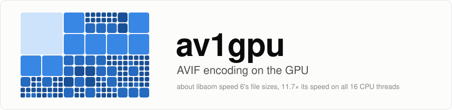
  </picture>
</p>

<p align="center">
  <a href="https://github.com/maddog107/av1gpu/releases"></a>
  <a href="https://github.com/maddog107/av1gpu/actions/workflows/ci.yml"></a>
  <a href="LICENSE"></a>
  
  
  <a href="docs/RESULTS.md"></a>
  <a href="https://github.com/maddog107/av1gpu/stargazers"></a>
</p>

<p align="center">
  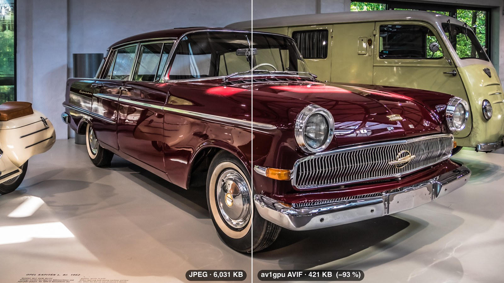<br>
  <sub>Left: the original 12 MP JPEG, 6,031 KB. Right: av1gpu's AVIF at the default quality, 421 KB.
  Photo: <a href="https://www.flickr.com/photos/yakobusan/20438833739">Untitled</a> by Jakob Montrasio, CC BY 2.0.</sub>
</p>

> [!TIP]
> **TL;DR:** av1gpu converts JPEGs to AVIF on an NVIDIA GPU **9× faster than libaom on 16 CPU threads, with the
> same file sizes**, using a third of one CPU core. Files come out **86 % smaller than the JPEGs** and **31 % smaller
> than WebP**, and it is **17× faster than NVENC**, the AV1 encoder built into the same GPU. 4:4:4, 10-bit, lossless
> and transparency included. One prebuilt binary, no CPU farm.

## ⚡ Overview

A CUDA encoder for AV1 still images that writes AVIF. Mode search, partitioning, reconstruction,
loop-filter decisions and entropy coding all run on the GPU's general-purpose CUDA cores. It does not
use NVENC, the GPU's fixed-function video encoder, which on the same card is 17× slower and makes about 26 %
bigger files ([below](#-same-gpu-av1gpu-vs-nvenc)). JPEG input is decoded on the GPU too, so a whole
batch of images stays in GPU memory from the JPEG bitstream to the finished AVIF bytes.

It was built for [Bellazon](https://www.bellazon.com), a forum with more than **15 million photos**:
32 million files with their thumbnails, 50 trillion pixels and 8.9 TB of originals. On one 70 W card
the whole archive is about 7 days of GPU time, while the server's CPUs carry on serving the site. At
the quality the forum chose, the AVIF files are 40 % smaller than the WebP it serves today, 1.5 TB less
to store and send (at equal quality, av1gpu's files are 31 % smaller than WebP's).

| | |
|---|---|
| **15 M+ photos** | Bellazon's archive (32 M files, 50 trillion pixels) in about 7 GPU-days on one card |
| **261 MP/s** | on one NVIDIA L4, a 72 W data-centre card (with `GP_ENCODERS=4`) |
| **0.36 s** | for one photo as its own process, CUDA start-up included (2.5 MP JPEG, L4), so uploads can be converted as they arrive |
| **+0.1 %** | file size against libaom speed 6 at equal quality (median BD-rate, SSIMULACRA2; +0.7 % against libaom with its tiling off) |
| **−31 %** | file size against WebP at equal quality |
| **0.3 cores** | of CPU while encoding JPEGs, so the CPU stays free for other work |
| **bit-exact** | every test encode decodes to the encoder's own reconstruction in dav1d and libaom |

## 🎬 See it run

99 camera photos (478 MP, 154 MB of JPEG) converted on an NVIDIA L4 (AWS g6.4xlarge), recorded in real time:

<p align="center">
  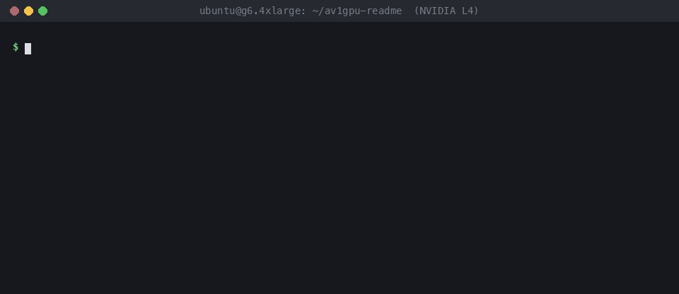
</p>

That run includes CUDA start-up; on longer batches the speed settles at the figures below.

## 📊 Results

Measured on an AWS g6.4xlarge (NVIDIA L4, AMD EPYC 7R13 with 16 vCPUs) with 100 public
[Open Images](https://storage.googleapis.com/openimages/web/index.html) photos from 0.18 to 24 MP, against
avifenc 1.4 with libaom 3.13.1 (`tune=iq`) and SVT-AV1 4.2.0 (`tune=3`, its still-image mode), one
avifenc per vCPU with avifenc's defaults (which tile images automatically). Full numbers, method and logs:
[docs/RESULTS.md](docs/RESULTS.md#nvidia-l4-aws-g64xlarge); reproduce them with [Benchmarks](#-benchmarks).

<picture>
  <source media="(prefers-color-scheme: dark)" srcset="docs/charts/tradeoff-dark.svg">
  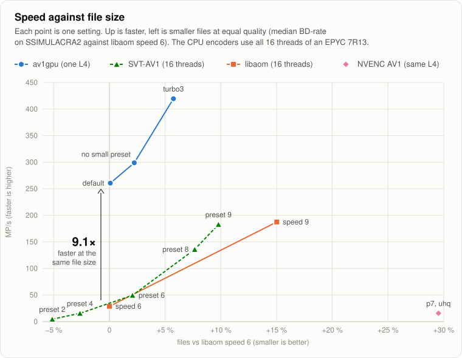
</picture>

**Speed against file size:** up is faster, left is smaller files. From libaom-speed-6 sizes up to +6 %, av1gpu
on one GPU is 4.4–8.6× faster than the best CPU encoder on all 16 threads (interpolating between SVT-AV1
presets). For the smallest files, SVT-AV1's slow presets go further (preset 2: −5.1 %, at 4.6 MP/s);
av1gpu's own `--preset slow` has not been timed on the L4 yet. Tuning the CPU side (`-march=native`, LTO,
PGO for SVT-AV1, the best thread split, no tiling) makes it 1–15 % faster with the same files; at
libaom-speed-6 sizes av1gpu is then 7.0–8.4× faster
([details](docs/RESULTS.md#cpu-builds-tuning-threads-and-tiling)).

Each encoder has a "small files" setting and a "fast" setting, so there are two fair match-ups. A third
compares av1gpu with NVENC, the AV1 hardware encoder built into the same GPU.

### 🐢 Smallest files: av1gpu default vs libaom speed 6 and SVT-AV1

<picture>
  <source media="(prefers-color-scheme: dark)" srcset="docs/charts/match-small-dark.svg">
  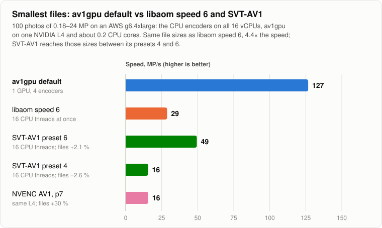
</picture>

**At the same file size, av1gpu is 9.1× faster than libaom running on all 16 CPU threads at once**,
and it leaves the CPU almost idle (0.3 of a core). SVT-AV1 brackets the same size with preset 6 (49 MP/s,
files 2.1 % bigger) and preset 4 (16 MP/s, 2.6 % smaller).

### 🐇 Fastest: av1gpu turbo3 vs SVT-AV1 preset 9 and libaom speed 9

<picture>
  <source media="(prefers-color-scheme: dark)" srcset="docs/charts/match-fast-dark.svg">
  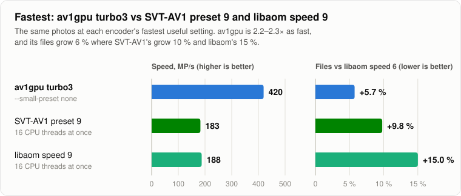
</picture>

**2.2–2.3× as fast as both, and av1gpu's files grow less:** +5.7 % against libaom speed 6, where SVT-AV1
preset 9 pays +9.8 % and libaom speed 9 +15 %.
av1gpu uses 0.4 of a CPU core; the CPU encoders need all 16 threads. libaom speed 10 is no faster than 9
for still images, and SVT-AV1 runs presets 10–13 as 9 when every frame is intra.

### 🆚 Same GPU: av1gpu vs NVENC

<picture>
  <source media="(prefers-color-scheme: dark)" srcset="docs/charts/match-nvenc-dark.svg">
  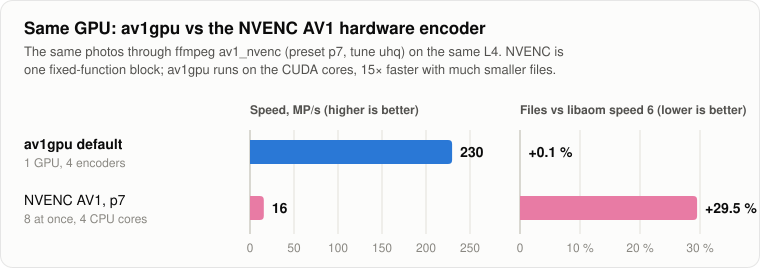
</picture>

**17× faster than the GPU's own AV1 encoder, with files 21 % smaller.** NVENC is a fixed-function block
(the L4 has two), so it tops out at about 16 MP/s however many encodes you run at once, and it keeps
4 CPU cores busy decoding JPEGs for it. Its files are 27.9 % bigger than libaom speed 6's at equal
quality, worse than libaom speed 9 (on the 76 photos with an even height; the image pipeline we used
decodes odd heights with wrong chroma, which makes it +29.5 % over all 99). Tested through ffmpeg `av1_nvenc` at its best-quality setting (`-preset p7
-tune uhq`) on 99 of the photos; details in
[docs/RESULTS.md](docs/RESULTS.md#nvenc-av1-on-the-same-l4).

### 🔌 Against an FPGA encoder card: Bluedot Pulsar-AVIF

**At its fastest setting, faster than a dedicated AVIF encoder card.** Bluedot's Pulsar-AVIF runs on an AMD
Alveo U250 FPGA card (about $11,000) and is quoted at 409.85 images/s on the Kodak set (24 images of 768 × 512,
encoded 24 at once; [web.dev, 2023](https://web.dev/articles/avif-updates-2023)). One L4, which rents for about
$0.80/hour, does **645 images/s** on the same images with `--preset turbo3 --small-preset none` (522 counting
CUDA start-up), 365 with `--small-preset none` and 152 with the default, which sends images below 1 MP to its
slower preset. Pulsar's quality settings and file sizes aren't published, so this compares speed only
([details](docs/RESULTS.md#fpga-bluedot-pulsar-avif)).

### 📈 Quality and file size

<picture>
  <source media="(prefers-color-scheme: dark)" srcset="docs/charts/quality-dark.svg">
  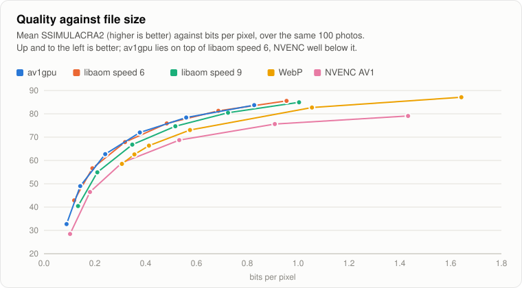
</picture>

<picture>
  <source media="(prefers-color-scheme: dark)" srcset="docs/charts/by-size-dark.svg">
  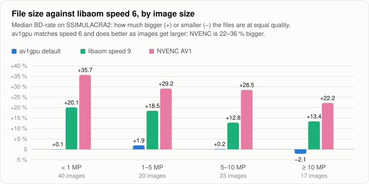
</picture>

| Encoder | MP/s | Files vs libaom s6 | Files vs WebP | CPU cores |
|---|---:|---:|---:|---:|
| **av1gpu** default, `GP_ENCODERS=4` | **261** | **+0.1 %** | **−30.6 %** | 0.3 |
| av1gpu `--small-preset none` | 299 | +2.2 % | | 0.3 |
| av1gpu `--preset turbo3 --small-preset none` | 420¹ | +5.7 % | | 0.4 |
| libaom speed 6, 16 × avifenc | 29 | 0 | −29.6 % | 16 |
| libaom speed 9, 16 × avifenc | 188 | +15.0 % | −18.7 % | 16 |
| SVT-AV1 preset 2, 16 × avifenc | 4.6³ | −5.1 % | −33.8 % | 16 |
| SVT-AV1 preset 4, 16 × avifenc | 15.5³ | −2.6 % | −31.7 % | 16 |
| SVT-AV1 preset 6, 16 × avifenc | 49³ | +2.1 % | −27.4 % | 16 |
| SVT-AV1 preset 8, 16 × avifenc | 136³ | +7.7 % | −23.6 % | 16 |
| SVT-AV1 preset 9, 16 × avifenc | 183³ | +9.8 % | −22.4 % | 16 |
| WebP (cwebp `-m 4`) | | +42.1 %⁴ | 0 | |
| NVENC AV1 (ffmpeg `av1_nvenc -preset p7 -tune uhq`), 8 at once | 16² | +29.5 %⁵ | −11.3 % | 4 |

¹ With the small-image preset on, `turbo3` runs at 331 MP/s, +1.2 %.
² Same L4 type, separate session, 99 photos; av1gpu's default (v0.3.0 then) ran at 116 MP/s alongside it.
³ On a c6a.4xlarge, the same EPYC 7R13 with 16 vCPUs, 99 photos; libaom ran alongside at 28.7 and 186.4 MP/s,
and its speed 6 files and scores were identical to the main run's.
⁴ Scored with each WebP's own ICC profile. The first published numbers (+45.1 %, and av1gpu −31.2 % against
WebP) lost it in dwebp's PNG, which made 13 photos with non-sRGB profiles look colour-shifted.
⁵ The image pipeline used for NVENC decodes photos with an odd height with wrong chroma; on the 76 even-height
photos NVENC is +27.9 % ([details](docs/RESULTS.md#nvenc-av1-on-the-same-l4)).

The CPU encoders ran with avifenc's defaults, which split most of these photos into up to 8 tiles. With one
tile they run at the same speed and make files about 0.5 % smaller, so against untiled libaom speed 6
av1gpu's default is +0.7 %, and SVT-AV1 presets 4, 6 and 9 are −2.9, +2.6 and +9.8 %. Builds with
`-march=native` and LTO write the same files 1–4 % faster, and SVT-AV1 with PGO 9–13 % faster
([details](docs/RESULTS.md#cpu-builds-tuning-threads-and-tiling)).

### 🎨 4:4:4 and 10-bit

<picture>
  <source media="(prefers-color-scheme: dark)" srcset="docs/charts/formats-dark.svg">
  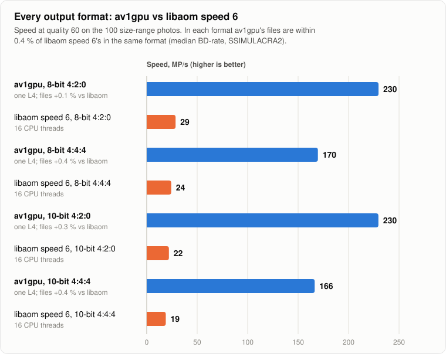
</picture>

`--yuv 444` (full-resolution colour, AV1 High profile) and `--depth 10`, alone or together, keep the same
picture: in every format av1gpu's files are within 0.4 % of libaom speed 6's in that format, at 8.1–11.5× the
speed. On these photos 10-bit makes files about 2 % smaller at equal quality for both encoders (av1gpu
−2.2 %, libaom −2.0 %), with no measurable speed cost for av1gpu. 4:4:4 makes little difference here, because the
sources are 4:2:0 JPEGs; it is for sources with full-resolution colour, such as PNG screenshots and graphics.
Details: [docs/RESULTS.md](docs/RESULTS.md#444-and-10-bit).

### 💎 Lossless

`--lossless` writes AVIFs that decode to exactly the input, for PNG and WebP; it refuses JPEGs, whose
lossless AVIF would be about twice their size, or more. On 47 PNGs (24 Kodak photos and 23 charts
and screenshots, 42.7 MP), with every output checked pixel for pixel in libavif with both decoders:

| Lossless encoder | Size vs the PNGs | Photos | Graphics | MP/s |
|---|---:|---:|---:|---:|
| **av1gpu `--lossless --ycgco-re`** | **90.6 %** | 11.99 MB | 4.82 MB | 45 |
| av1gpu `--lossless` (GBR) | 108.5 % | 13.37 MB | 6.74 MB | 44 |
| avifenc `-l --cicp 1/13/16` (speed 6) | 92.2 % | 12.40 MB | 4.71 MB | 8.8 |
| avifenc `-l` (speed 6) | 116.0 % | 13.69 MB | 7.83 MB | 9.3 |
| cwebp `-lossless` | 66.5 % | 11.34 MB | 0.98 MB | 44 |

av1gpu beats libaom's lossless AVIF on size and is about 5× faster, but lossless WebP is much smaller,
especially on graphics. (av1gpu's speed is for the set repeated 4×; a single pass of 42.7 MP, CUDA start-up
included, ran at 19 MP/s. CPU encoders: 16 single-threaded processes on the same 16-vCPU host.) The table is
without palette mode (below), which takes 10 % off the graphics and leaves the photos unchanged. Details:
[docs/RESULTS.md](docs/RESULTS.md#lossless).

### 🖥️ Screen content and flat colour

Screenshots, charts and flat-colour art that pass a screen-content detection get AV1's palette mode. At equal
SSIMULACRA2 that makes the 40 screen images of the [palette study](docs/PALETTE.md) about 24 % smaller (median
BD-rate). That is 9.5 % smaller than libaom speed 6 with palette, and 3.3 % bigger than libaom with palette and
intra block copy. The flat-colour PNGs that pass detection are 22 % smaller. Photos never pass, so their files and
speed are unchanged. Screen content encodes at about 0.37× the speed without it (57 against 153 MP/s on the L4). `--palette off`
turns palette mode off, and `--palette on` tries it on every image.

### 🪟 Transparency

PNG and WebP files with transparency get an AVIF alpha channel: a second, monochrome AV1 image, laid out as
libavif writes it, and decoded with exact alpha by libavif with both dav1d and libaom. Alpha quality follows
`--quality` by default, as in avifenc 1.2+; `--alpha-quality 100` (or `--lossless`) keeps it exact. Files
without transparency are unchanged, byte for byte. On 39 test PNGs (logos, icons, stickers, UI elements,
masked photos, charts):

| Encoder | Total | Alpha part | Alpha | MP/s |
|---|---:|---:|---|---:|
| av1gpu default (q60, alpha q60) | 699 KB | 91 KB | 50.2 dB | 50 |
| av1gpu `--alpha-quality 100` | 1,088 KB | 480 KB | exact | 44 |
| avifenc `--qalpha 100` (its default 4:4:4) | 1,274 KB | 528 KB | exact | 12 |
| avifenc `-y 420 --qalpha 100` | 1,208 KB | 528 KB | exact | |
| av1gpu `--lossless` | 7.72 MB | 486 KB | exact | 30 |
| avifenc `-l` | 7.96 MB | 528 KB | exact | 8.2 |
| cwebp `-lossless` | 4.75 MB | | exact | 27 |

Exact alpha comes out about 9 % smaller than libaom's. The lossy colour rows are not matched for quality
(the alpha rows are). The av1gpu rows are without palette mode (`--palette off`); by default palette mode takes
15 of the 39 images, which makes the set 2 % smaller (685 KB) and slower to encode (32, 30 and 29 MP/s).
Details: [docs/RESULTS.md](docs/RESULTS.md#transparency).

### 👁️ A second metric: CVVDP

<picture>
  <source media="(prefers-color-scheme: dark)" srcset="docs/charts/metrics-dark.svg">
  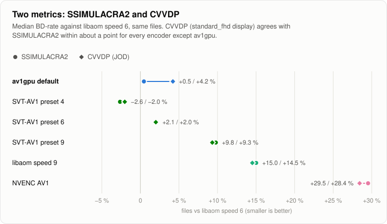
</picture>

SSIMULACRA2 does not model screen size or viewing distance, so we also scored the same files with CVVDP
(ColorVideoVDP, `standard_fhd`: a 24-inch 1080p screen at 60 cm, photos shown at 100 %). It agrees with
SSIMULACRA2 within about a point for every encoder except av1gpu, which it puts at **+4.2 %** against libaom
speed 6 instead of +0.1 %. The difference is in luma and grows with image size. At that file size av1gpu is
still about 3.6× faster than SVT-AV1 and 5.3× faster than libaom (interpolating between presets). Every AVIF
encoder here reaches 9.5 JOD, a high-fidelity level, on all 99 photos: av1gpu at 0.46 bits per pixel, libaom
speed 6 at 0.45, SVT-AV1 at 0.43–0.49 and WebP at 0.67. Details:
[docs/RESULTS.md](docs/RESULTS.md#cvvdp-a-second-metric).

### 🖼️ What the files look like

The default quality (`--quality 60`, the avifenc scale) turned the 100 test JPEGs, 160.4 MB, into
22.5 MB of AVIF, at a mean SSIMULACRA2 of 72 ("high quality"; 90 is visually lossless). `--quality 70`
gave 33.4 MB at 78. Five of the photos, one from each size class:

<table>
  <tr>
    <td align="center" width="20%">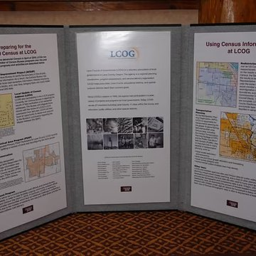<br><b>90 KB → 27 KB</b><br>−70 % · 640 × 427</td>
    <td align="center" width="20%"><br><b>177 KB → 60 KB</b><br>−66 % · 1024 × 768</td>
    <td align="center" width="20%">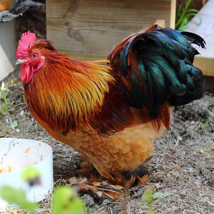<br><b>2.06 MB → 177 KB</b><br>−91 % · 1920 × 1280</td>
    <td align="center" width="20%">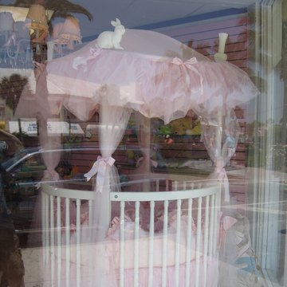<br><b>1.88 MB → 213 KB</b><br>−89 % · 2304 × 3072</td>
    <td align="center" width="20%">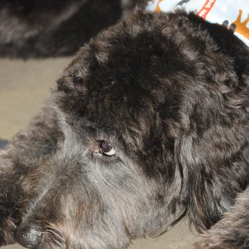<br><b>6.08 MB → 578 KB</b><br>−90 % · 2848 × 4288</td>
  </tr>
</table>

SSIMULACRA2 against the source: 67.9, 77.3, 73.6, 71.1 and 69.0. Thumbnails are cropped from av1gpu's
output. Photos (CC BY 2.0): [DSC08815](https://www.flickr.com/photos/stupiddingo/4016599113) by Brent,
[Fresh Red Peppers at La Boqueria](https://www.flickr.com/photos/oh-barcelona/4811363097) by Oh-Barcelona.com,
[Cock](https://www.flickr.com/photos/kallegustafsson/5866854319) by Kalle Gustafsson,
[St.Armands Circle](https://www.flickr.com/photos/philliecasablanca/2037727892) by Phil Whitehouse and
[DSC_2946](https://www.flickr.com/photos/hockeyholic/7881222604) by Andy Blackledge.

Camera originals shrink the most, because they are stored at high JPEG quality. SSIMULACRA2 here compares
the AVIF with the decoded JPEG, not with the scene.

With v0.3.0's 2 × 2 tiles the RTX PRO 2000 and the L4 produced byte-identical files for all five; these are the
L4's files with the 4 × 4 default.

### 🔍 Same file size, side by side

Each encoder was pushed to the size of av1gpu's file (the highest quality setting that fits), then the
same spot was cropped and enlarged 2×. av1gpu and libaom speed 6 keep the chrome bars of the grille
crisp; speed 9 and WebP soften them, and JPEG turns them into blocks.

<p align="center">
  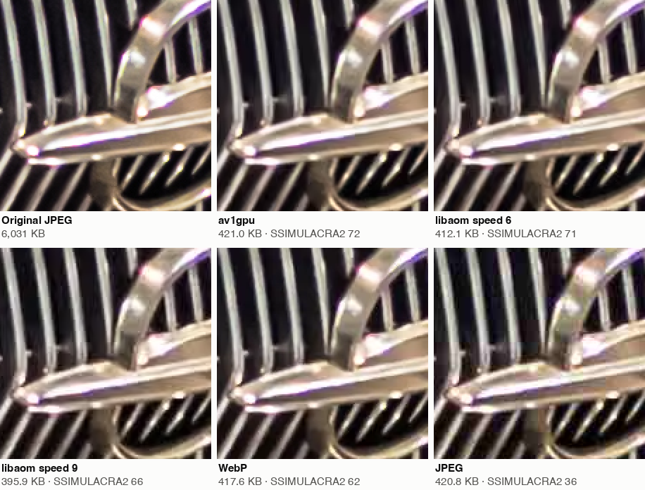
</p>

<details>
<summary>A second example: a dog's eye and fur, 12 MP (578 KB each)</summary>
<p align="center">
  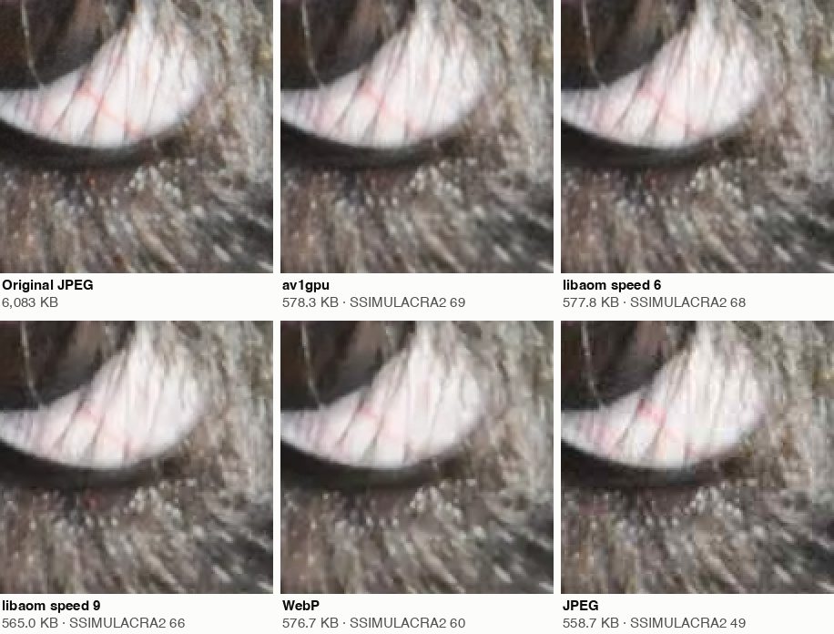
</p>
</details>

Crops of [Untitled](https://www.flickr.com/photos/yakobusan/20438833739) by Jakob Montrasio and
[DSC_2946](https://www.flickr.com/photos/hockeyholic/7881222604) by Andy Blackledge (CC BY 2.0), re-encoded
with av1gpu (4 × 4 default, on the L4), avifenc 1.4 / libaom 3.13 (`tune=iq`), cwebp `-m 4` and libjpeg 4:2:0.

**Every output is a standard AV1 bitstream, and the tests check that by decoding.** The encoder's
own reconstruction must match what dav1d and libaom's decoder produce, byte for byte. That held for
all 1,475 held-out encodes on the development GPU and all 1,000 encodes of the L4 run, and the test
suite keeps checking it (see [Correctness](#-correctness)).

## 🚦 Status

av1gpu is a working encoder that runs in production on Bellazon. It is also a young, single-developer
project. Before you rely on it, note:

- **It has been tested on three GPU models:** the RTX PRO 2000 Blackwell it was developed on (compute
  capability 12.0), an NVIDIA L4 (8.9, on AWS; see [docs/RESULTS.md](docs/RESULTS.md#nvidia-l4-aws-g64xlarge)) and
  an RTX PRO 4500 Blackwell (12.0, on AWS), which wrote the same bytes as the L4 for all 5,679 files of the v0.9.0
  release check. A contributor's speed run on a GeForce RTX 5090 (12.0) gave byte-identical output too
  ([results](docs/RESULTS.md#geforce-rtx-5090-contributed-by-pickae)). The code uses only standard CUDA
  features, with no tensor cores, no architecture-specific intrinsics and no large shared-memory
  carve-outs. It builds for compute capability 7.5 through 12.0. Other GPUs should work but have not
  been run yet. Reports are welcome, especially `tests/decoder_gate.py` results.
- Output: 8- or 10-bit (`--depth 10`), 4:2:0, 4:4:4 (`--yuv 444`) or monochrome AV1, intra only. In 4:2:0,
  4:4:4 and 4:2:2 JPEGs are downsampled; in 4:4:4, subsampled JPEGs are upsampled exactly as libjpeg-turbo
  does. `--lossless` codes PNG and WebP exactly (RGB as GBR or YCgCo-Re) and refuses JPEGs. PNG and WebP
  transparency becomes an AVIF alpha channel. There is no 4:2:2 output or animation.
- Some inputs are not handled on the GPU path. The batch mode skips them and lists them on stderr, so
  you can send them to another encoder: CMYK/YCCK JPEGs, 12-bit JPEGs, images over 35.6 MP and
  unreadable files. PNG and WebP inputs are decoded on the CPU, on every core av1gpu may use.
- Palette mode runs on screen content and flat-colour images that pass its detection (`--palette`). Tools not
  implemented: intra block copy, loop restoration, superres, film grain.

## 📦 Download

Each [release](https://github.com/maddog107/av1gpu/releases) has four builds, each with a `.sha256`. Take the
CUDA 13 build for your system unless your NVIDIA driver is older than 580:

| File | Built with | NVIDIA driver |
|---|---|---|
| `av1gpu-<version>-linux-x86_64.tar.gz` | CUDA 13.4 | 580 or newer |
| `av1gpu-<version>-linux-x86_64-cuda12.tar.gz` | CUDA 12.9 | 525 or newer |
| `av1gpu-<version>-windows-x86_64.zip` | CUDA 13.4 | 580 or newer |
| `av1gpu-<version>-windows-x86_64-cuda12.zip` | CUDA 12.9 | 528 or newer |

All four run on GPUs from Turing to Blackwell (compute capability 7.5 to 12.0) and need only the driver. The
Linux binaries have the image libraries and nvJPEG linked in; for Windows, see [Windows](#-windows). Both builds
give the same files. The CUDA 13 build is faster on Blackwell (+14–16 % on an RTX PRO 4500) and starts
quickly: one JPEG as its own process takes 0.34 s there (v0.10.0, driver 595), CUDA start-up included. With the
CUDA 12 build on Blackwell, drivers 615 and newer recompile its kernels when they
load (a fix for a reconvergence bug). That added 8–15 s to every start without a warm CUDA compute cache
([#49](https://github.com/maddog107/av1gpu/issues/49)).

A GPU newer than these first has to compile the code from PTX, which took over ten minutes in a test. The
result is then kept in the CUDA compute cache. That cache holds 1 GB by default and is shared with other CUDA
programs, so give av1gpu its own, e.g. `CUDA_CACHE_PATH=~/.cache/av1gpu-cuda CUDA_CACHE_MAXSIZE=4294967296`.

## 🛠️ Building

On Linux you need CUDA 12.0 or newer (12.8 or newer to target Blackwell), CMake 3.24 or newer, a C++17
compiler, and libjpeg(-turbo), libpng and libwebp development packages. For Windows, see
[Windows](#-windows) below.

```bash
# Ubuntu / Debian (plus the CUDA toolkit from NVIDIA)
sudo apt install cmake ninja-build pkg-config libjpeg-turbo8-dev libpng-dev libwebp-dev

cmake -S . -B build -G Ninja -DCMAKE_BUILD_TYPE=Release -DCMAKE_CUDA_ARCHITECTURES=native
cmake --build build
```

`-DCMAKE_CUDA_ARCHITECTURES=native` builds only for the GPU in the machine, which is much quicker.
Leave it out to build a portable binary for compute capability 7.5 through 12.0. The binary links the
CUDA runtime statically, so at run time it needs only the NVIDIA driver and `libnvjpeg`.
For Blackwell, build with CUDA 13.3 or newer: from driver 615, NVIDIA recompiles Blackwell kernels built by
nvcc older than 13.2.2 when they load (a fix for a reconvergence bug), which added 8–15 s to every start
without a warm compute cache ([#49](https://github.com/maddog107/av1gpu/issues/49)).

Most of the build time goes to the four wavefront kernels (`encoder/src/k_recon*.cu`). How much memory
and time each one takes depends on the CUDA version and the targets: up to 18 GB with CUDA 12.8, about
10 GB and 10 minutes for Blackwell targets with CUDA 13.2 to 13.4, under 2 GB and 2 minutes for one older
GPU. CMake compiles as many of them at once as the free memory allows (one per 20 GB, at most 4); with 80
GB or more free, a native Blackwell build took 13 minutes instead of 40. `-DAV1GPU_RECON_JOBS=N` sets the
number.

`-DAV1GPU_CUDA=OFF` builds just the CPU pieces: the bitstream writer, the AVIF muxer and the fuzz
test. That build needs no CUDA toolkit.

**Building with Clang.** Clang can compile the CUDA code instead of nvcc. Tested with Clang 23.1.5 (from
[apt.llvm.org](https://apt.llvm.org)), CUDA 13.0 and CMake 4.2.3 on an L4:

```bash
cmake -S . -B build-clang -G Ninja -DCMAKE_BUILD_TYPE=Release -DCMAKE_CUDA_COMPILER=clang++-23 \
  -DCUDAToolkit_ROOT=/usr/local/cuda-13.0 -DCMAKE_CUDA_ARCHITECTURES=native
cmake --build build-clang
```

`-DCUDAToolkit_ROOT` picks the toolkit: its headers, its `ptxas` and the libraries that get linked. Clang 23
does not compile CUDA 13.2's CCCL headers yet (they declare host-only deduction guides, which Clang rejects).
With a CUDA 13 toolkit, CMake 3.28 (Ubuntu 24.04) cannot identify Clang as a CUDA compiler, because its
check compiles for sm_52, which CUDA 13 dropped; use a newer CMake (`pip install cmake`).

On the L4, the Clang build took 1:47 instead of nvcc's 4:54 (16 cores, sm_89), with under 0.8 GB per
`k_recon` file instead of 1.5–1.7 GB. It passed the unit tests and the decoder gates, and 1,157 of 1,158 test encodes were
byte-identical to nvcc's (the other one differs by 4 bytes, at equal SSIMULACRA2). It encodes 8–17 % slower
(v0.3.0 code, 0.18–24 MP set: default 70 vs 83 MP/s, turbo3 103 vs 125, slow 14.4 vs 15.7), so the release binaries stay
with nvcc.

## 💻 Windows

From v0.5.0 the [releases](https://github.com/maddog107/av1gpu/releases) also have Windows x64 zips (see
[Download](#-download)). The CUDA 13 zip needs driver 580 or newer and carries `nvjpeg64_13.dll`. The
`-cuda12` zip needs 528 or newer and carries `nvjpeg64_12.dll`. Unzip either anywhere: `av1gpu.exe` needs only
the driver and that DLL beside it, because the C++ runtime and the image libraries are linked in. The options
are the same as on Linux:

```bat
av1gpu.exe photo.jpg photo.avif
av1gpu.exe --batch C:\photos --outdir C:\avif
```

Paths may use `\` or `/`, and file names may be non-ASCII (Windows 10 version 1903 or newer, Windows
Server 2022). Batch list files are UTF-8, one path per line; Windows line ends are fine. `--outdir`
directories are created as needed.

Tested on an L4 under Windows Server 2022 (AWS g6.4xlarge): every output of 30 test runs (1,226 files)
and of the decoder-gate encodes (2,125 files) was byte-identical to the Linux build's. With v0.5.0 it ran at 67–83 % of the Linux speed on the same instance type
with hardware-accelerated GPU scheduling on (JPEG 86 against 128 MP/s), and slower without it; Windows has not been timed with v0.6
([results](docs/RESULTS.md#windows)). The CUDA 13 and `-cuda12` zips (v0.7.1's code) give the same files as the Linux
tarballs (224 files each, on driver 582.78). The GPU must be in WDDM mode, as GeForce and RTX cards are: TCC mode,
the default of data-centre GPUs under NVIDIA's data-centre driver, has no CUDA memory pools, and av1gpu
stops with an error that says so.

Differences from Linux:

- The thread counts follow the process's CPU affinity (`start /affinity`) or all the machine's
  processors. CPU rate limits of Windows job objects and containers are not read.
- The tests (`ctest`, `tests/*.py`) run on Linux only.
- On Windows Server 2019 and Windows 10 before version 1903, non-ASCII file names do not work (those
  versions ignore the executable's UTF-8 code page setting).

**Building on Windows.** You need Visual Studio 2022 or its Build Tools with the "Desktop development with
C++" workload. `tools\windows\build.ps1` gets the rest: the parts of CUDA av1gpu uses, from NVIDIA's
redistributable archives (13.4 by default, about 100 MB; `-CudaVersion 12.9.1` for the `-cuda12` build;
`-CudaRoot` uses an installed toolkit instead), and libjpeg-turbo, libpng, zlib and libwebp, built static by a
pinned vcpkg release. CMake comes with the workload's default "C++ CMake tools" component; Ninja is downloaded
if it is not there.

```powershell
powershell -ExecutionPolicy Bypass -File tools\windows\build.ps1 -Archs native
```

`build\av1gpu.exe` then needs the toolkit's `nvjpeg64_13.dll` (in `bin\x64`; CUDA 12: `nvjpeg64_12.dll` in
`bin`) beside it. Leave out `-Archs` for every GPU from Turing to Blackwell; `-Package` makes the release zip
(`-PackageSuffix -cuda12` names it as the release does).

## 🚀 Usage

```bash
# one image
build/av1gpu photo.jpg photo.avif

# a directory (or a text file with one path per line): many images in flight at once
build/av1gpu --batch photos/ --outdir avif/            # writes avif/<name>.jpg.avif

# quality uses the avifenc -q scale (0..100; default 60)
build/av1gpu --batch photos/ --outdir avif/ --quality 70

# slower, smaller files
build/av1gpu --batch photos/ --outdir avif/ --preset slow
```

Batch mode is the fast path. It decodes, encodes and entropy-codes several batches at once, so the
GPU stays busy. One process per image, as an upload pipeline runs it, pays for CUDA start-up every time,
but briefly: on the L4 a cold `av1gpu photo.jpg photo.avif` takes 0.36 s for a 2.5 MP JPEG, 0.47 s for
10 MP and 0.35 s for a 512 × 384 thumbnail, and a `--batch` of a photo and its thumbnail 0.58 s (0.34,
0.42, 0.34 and 0.67 s on an RTX PRO 4500 with v0.10.0; [details](docs/RESULTS.md#single-image-start-up)).

| Option | Meaning |
|---|---|
| `--quality Q` | 0–100 on avifenc's `-q` scale with `tune=iq` (60 → AV1 qindex 120) |
| `--qindex Q[,Q2,…]` | AV1 `base_q_idx` directly. In batch mode, several values run one pass each (add `--name-q` to suffix outputs with `.q<Q>`) |
| `--preset P` | `slow`, `base`, `fast`, `faster`, `turbo` (default), `turbo2`, `turbo3` |
| `--small-preset P` | preset for images below 1 MP (default `base`; `none` disables) |
| `--tiles MIN_MP,C,R` | 2^C × 2^R uniform tiles for images of at least MIN_MP megapixels, instead of the preset's tiling (below) |
| `--yuv 420` / `444` | chroma format (default `420`; `444` is AV1 High profile and keeps full-resolution colour) |
| `--lossless` | exact (AV1 lossless). PNG/WebP RGB as GBR 4:4:4 at the source depth (as `avifenc -l`). JPEGs are refused (skipped in batch mode): a lossless AVIF of a JPEG is about twice its size, or more |
| `--ycgco-re` | with `--lossless`: RGB as YCgCo-Re (`--cicp 1/13/16` in avifenc), 8-bit RGB → 10-bit 4:4:4; usually smaller |
| `--palette M` | palette mode for screen content and flat colours: `auto` (default) tries it on the images that pass a screen-content detection (photos do not, and their output is unchanged), `on` on every image, `off` never (the output and speed without palette mode, as in v0.7). Lossy: luma palettes; lossless: luma and chroma ([docs/PALETTE.md](docs/PALETTE.md)) |
| `--alpha-quality Q` | quality of the alpha channel of PNG/WebP files with transparency: defaults to `--quality`, as in avifenc 1.2+; `100` is lossless (also with `--lossless`) |
| `--no-alpha` | drop transparency as before alpha support (PNG colour composited onto black) |
| `--depth 8` / `10` | bit depth (default 8; 16-bit PNGs keep 10 bits, 8-bit sources are scaled to the 10-bit range) |
| `--tune iq` / `none` | libaom `tune=iq` tools: quantization matrices, variance-boost delta-q, chroma delta-q, deblocking and CDEF strength choice (default `iq`) |
| `--crop WxH+X+Y` | crop the decoded image on the GPU at any pixel offset (also `X,Y,W,H`): source pixels before the EXIF rotation, clipped to the image like ImageMagick's `-crop`. A crop outside the image is an error (skipped in batch mode); with `--lossless` the crop is exact |
| `--max-size WxH` / `--max-height H` | shrink to fit inside `WxH` (`Wx` or `xH` for one side) on the GPU after the crop, never enlarge: ImageMagick's `-resize 'WxH>'` size and its Lanczos filter. The box is the displayed size (turned for EXIF rotations by 90°) |
| `--max-mp MP` | largest picture encoded, after crop and resize (default 35.6, AV1 level 6.3; single PNG and WebP images have no limit, as before). Larger pictures are written with level 31 (no limits): dav1d and libavif decode them, decoders that enforce levels may not |
| `--max-input-mp MP` | largest source decoded (default: the `--max-mp` limit); with a crop or `--max-size`, a larger source is decoded at full size and encoded once it fits |
| `--resize GEOMETRY` | ImageMagick's `-resize` geometry on the GPU: `W`, `xH`, `WxH` (fit inside), `WxH^` (fill), `WxH!` (exactly), with `>` (only shrink) or `<` (only enlarge); `N%`, `N%xM%`; `@AREA`. Lanczos when shrinking (as `--max-size`), Mitchell when enlarging, as ImageMagick |
| `--trim` | remove the border, as ImageMagick's `-trim`: the box of the pixels that differ from the corner colours by more than `--fuzz D%` (ImageMagick's `-fuzz`). An image that is all border is encoded whole |
| `--trim-margin N\|N%`, `--trim-limits MIN%,MAX%`, `--trim-lightness L`, `--skip-blank P` | conditions on `--trim` for scans: keep N pixels (or N % of the shorter side) of the border; trim only when that removes MIN–MAX % of both sides; only when 3 of the 4 corners are at least L % light (paper, not a dark frame); skip an image whose trim would remove more than P % of a side (blank) |
| `--auto-level`, `--level B%,W%[,G]`, `--gamma G`, `--negate` | ImageMagick's tone operators on each gamma-encoded RGB channel, on the GPU |
| `--grayscale METHOD`, `--colorspace Gray` | monochrome output: ImageMagick's `-grayscale` methods (`Rec601Luma`, `Rec709Luma`, `Average`, `Brightness`, `Lightness`, `RMS`); `--colorspace Gray` is `Rec709Luma`, as in ImageMagick 7 |
| `--cpu-entropy` | entropy-code on the CPU (produces bytes identical to the GPU coder) |
| `--stats` | print a JSON line with timings, throughput and CPU use |
| `--debug-outputs` | also write `<out>.obu` and `<out>.recon.yuv` for decoder comparisons |
| `--no-defaults` | start from the bare encoder instead of the defaults (research use) |

`av1gpu --help` lists the expert tuning options. The defaults are `--quality 60 --tune iq
--edge-filter --preset turbo --small-preset base --gpu-entropy`.

Tiles: the default preset, `turbo`, splits images of 2 MP and more into 4 × 4 tiles (`--tiles 2,2,2`;
`turbo2` and `turbo3` too). `base`, `slow` and the other presets use only the tiles AV1
requires (for frames wider than 4,096 pixels or larger than 9.4 MP), which is also what MIN_MP `0` means.
`--tiles` replaces the preset's choice wherever it appears on the command line. It also applies to the
images `--small-preset` encodes and to lossy alpha frames; lossless frames are tiled by `--ll-tile-area`
(see `--help`) unless that is `0`. An image too small for the requested grid gets the minimum tiling.
More tiles shorten the wavefront's serial chain and cost a little compression; deblocking and CDEF work
across tile edges, so they leave no visible seams. On the L4 (58 SMs; size-range set, default settings,
median of 6, v0.9.0), 4 × 4 runs at 252.4 MP/s against 230.0 for 2 × 2 (`2,1,1`, the default up to v0.3.0;
+10 %), and 8 × 8 (`2,3,3`) at 269.0 (+17 %); 4 × 4 cost +0.58 % BD-rate against 2 × 2 on the photos of 2 MP and
more (SSIMULACRA2; CVVDP +0.56 %). Over all 100 size-range photos it moved the default from −0.1 % to +0.1 %
against libaom speed 6; images below 2 MP are byte-identical. In a contributed measurement on an RTX 5090
(170 SMs), 4 × 4 was 39 % faster than 2 × 2 for 0.2 % more bytes.

Batch-mode environment variables: `GP_ENCODERS` (concurrent encoders, default 3), `GP_ENCODE_MP`
(megapixels per GPU batch, default 48), `GP_INGEST_WORKERS` (JPEG parsing threads) and `GP_FALLBACK_WORKERS`
(PNG and WebP decoding threads). The two thread counts default to one per CPU that av1gpu may use: the
affinity mask (`taskset`, cpusets) or a cgroup CPU limit (`docker --cpus`, Kubernetes) if lower. Decoded
PNG and WebP images wait on the GPU for an encoder, at most `GP_FALLBACK_QUEUE_MP` megapixels of them
(default twice `GP_ENCODE_MP`).
The encoder needs about 1 GB of GPU memory with these settings, and the JPEG decoder about 0.6 GB more.
`GP_INGEST_DECODER=1` forces the CPU-entropy-decode + GPU-IDCT JPEG path on GPUs without a hardware
JPEG engine. av1gpu also falls back to that path automatically.

In a batch list, a line may add TAB-separated `crop=WxH+X+Y`, `max-size=WxH` and `resize=GEOMETRY` options for its
image; they replace `--crop` / `--max-size` / `--resize` for that image. A line that names an existing file as a whole is a path, and a
line with a bad option is skipped like an unreadable file. Crop and resize run on the GPU after decoding, on the
planes that are about to be encoded: the image is decoded once, at full size, and there is no intermediate
file. The resize filters the YCbCr planes (gamma-encoded, as ImageMagick filters sRGB) with ImageMagick's
Lanczos taps, 4:2:0 chroma at its own sample positions, and writes 10-bit output straight from the filtered
values. Images with transparency are filtered with alpha-weighted colour, as ImageMagick does, so the colour
stored under transparent pixels does not bleed into the edges (ImageMagick's default filter for such images
is Mitchell; av1gpu uses Lanczos for all). Output sizes match ImageMagick 7's geometry; from the same 16-bit
RGB photo the planes differ from `magick -resize` by 0.19 of a 10-bit step on average (67 dB PSNR), from JPEGs
by about 0.5 (62 dB; ImageMagick's own decode differs by about 0.7 with no resize). Shrinking 3840 × 5586
pages to 2960 rows on the GPU runs at 169 MP/s of output on the L4, against 195 for pages shrunk beforehand
([results](docs/RESULTS.md#crop-and-resize-contributed-by-pickae)).

The other image operations run on the same decoded planes, in a fixed order: `--crop`, `--trim`, the tone
operators (`--auto-level`, `--level`, `--gamma`, `--negate`), the resize, then `--grayscale`. `--trim` compares
whole RGB samples, as ImageMagick does on its decode: on 1,621 comic pages and 120 photos its box had the size of
`magick -fuzz F -trim`'s for every image at 0, 3 and 10 % fuzz. Its conditions are what a comic converter decides
a trim by, so that the decision needs no CPU decode: on the same pages `--trim --fuzz 10% --trim-margin 1%
--trim-limits 1%,20% --trim-lightness 80 --skip-blank 99` reached the decision and the size of that converter's
ImageMagick road on every page. The tone operators and `--grayscale` work on the RGB of each pixel (4:2:0
chroma: the mean of its 2 × 2 pixels' new chroma) and are within one or two steps of ImageMagick's output; a
steep curve (`--gamma 2` near black) magnifies the rounding of the decoded planes to a few steps. Without these
options the output is byte-identical to before ([results](docs/RESULTS.md#trim-resize-tone-and-gray-contributed-by-pickae)).

AVIF files made from JPEGs carry the source's ICC profile (PNG and WebP profiles are not read yet). EXIF orientation is signalled with `irot`/`imir` rather
than by rotating pixels.

[examples/](examples/) has a directory converter with an avifenc fallback for skipped files, and an
nginx configuration that serves `image.jpg.avif` to browsers that accept AVIF.

## ✅ Correctness

The encoder keeps its own copy of the decoded picture. It needs that copy for prediction, and it is
also used to check every output against independent decoders:

```bash
# CPU only (no GPU needed): random legal encoder decisions -> av1core bitstream writer -> dav1d and aomdec
build/av1g_fuzz --count 1000            # or: ctest --test-dir build

# full GPU encoder, batch mode: every image must decode bit-exactly in dav1d and aomdec
tests/decoder_gate.py --bin build/av1gpu --images bench/images --q 60,120,180

# GPU entropy coder and GPU loop filters against the CPU reference
build/gpu_fuzz_test --count 2000
build/gpu_postfilter_test
```

The fuzzers and gates cover 4:2:0, 4:4:4 and monochrome at 8 and 10 bits (pass the av1gpu options after
`--`, e.g. `tests/decoder_gate.py ... -- --yuv 444 --depth 10`). `dav1d` and `aomdec` must be on `PATH`
(Ubuntu: `apt install dav1d aom-tools`), or set `AV1G_DAV1D` / `AV1G_AOMDEC`. The CUDA kernels are also run under compute-sanitizer
(memcheck, racecheck, synccheck): memcheck and synccheck are clean, and racecheck's reports are explained in
[docs/RESULTS.md](docs/RESULTS.md#correctness).

## 📏 Benchmarks

`bench/` reproduces the comparison on 100 public JPEGs from the
[Open Images](https://storage.googleapis.com/openimages/web/index.html) validation set (CC BY 2.0,
attribution in the CSV, about 1 MP each):

```bash
bench/fetch_images.py                                   # -> bench/images (33 MB, SHA-256 checked)
bench/bench.py --images bench/images --out bench/results/$(hostname)
```

It measures av1gpu throughput (the median of 3 runs after a warm-up) against all CPU threads running
avifenc at speeds 6 and 9. It also encodes every image at six quality points with av1gpu, libaom s6,
libaom s9 and WebP, scores them with SSIMULACRA2 and reports per-image BD-rates. It needs `avifenc`,
`avifdec`, `cwebp`, `dwebp` and libjxl's `ssimulacra2`; the script header shows how to get them. Results
from other GPUs are very welcome.

These images are small (about 1 MP), where the speed preset matters most. On the held-out set, small
images were where av1gpu compared worst against libaom and large images where it compared best. For a
spread of sizes there is a second set of 100 images from 0.18 to 24 MP (478 MP; the summary also breaks
the BD-rates down by size):

```bash
bench/fetch_images.py --manifest bench/openimages_v4_gamut.csv --out bench/images_gamut
bench/bench.py --images bench/images_gamut --out bench/results/$(hostname)-gamut
```

One original in that set (`9fba6f263f3c4f3e`) has since been changed on Flickr, so `fetch_images.py`
skipped it with a hash mismatch and the published runs used 99 images; since 2026-10-31 it downloads
again.

`bench/formats.py` runs the same comparison in every output format (`--yuv 444`, `--depth 10`) against libaom
in the same format, and `bench.py --cvvdp standard_fhd` adds CVVDP scores next to SSIMULACRA2
(`pip install cvvdp`; it runs on the GPU through PyTorch).

Speed runs repeat the set up to 1,000 MP (`--min-mp`), so that CUDA start-up does not dominate. Other
av1gpu settings can be timed through a wrapper script (`--av1gpu`, `--gpu-label`), and `--aom-speeds`
picks the libaom speeds to compare. With an avifenc built with SVT-AV1, `--svt-presets 2,4,6,8,9
--svt-tune 3` adds SVT-AV1 (`--skip-gpu` runs the CPU encoders alone). `--avifenc-threads N` runs
avifenc `-j N`, 16 / N at once, and `--no-tiling` encodes one tile per image.

## ⚙️ How it works

<picture>
  <source media="(prefers-color-scheme: dark)" srcset="docs/charts/pipeline-dark.svg">
  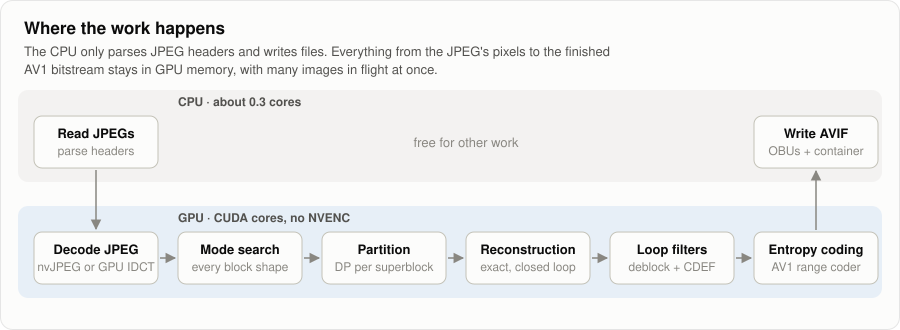
</picture>

Short version (details in [docs/ARCHITECTURE.md](docs/ARCHITECTURE.md)):

1. **Ingest.** JPEGs are parsed on the CPU and decoded with nvJPEG's hardware engine where one exists.
   Otherwise libjpeg-turbo does the entropy decoding on the CPU and the GPU does the IDCT. Either
   way the planes are bit-exact with libjpeg-turbo, and they are packed into size-classed batches in
   GPU memory.
2. **Analysis.** Every block shape from 4×4 to 64×64 is evaluated at every position. An open-loop
   SATD screen of the luma intra modes (directional with angle deltas, smooth, Paeth, DC) keeps the
   top K. Those K get an exact-rate RD check, then a transform-type search.
3. **Partition DP.** A dynamic program over each 64×64 superblock picks the partition tree.
4. **Closed loop.** Superblocks are reconstructed in wavefront order with the real, already-decoded
   neighbours. The top candidates are re-checked with exact entropy contexts. Chroma modes, CfL,
   quantization (with quantization matrices and per-superblock delta-q) and the exact integer inverse
   transforms run here, giving a bit-exact reconstruction. Many images are in flight at once, which
   hides the wavefront's serial dependencies.
5. **Loop filters.** Deblocking levels and CDEF strengths are chosen and applied on the GPU. The
   choice follows libaom's search for `tune=iq`.
6. **Entropy coding.** Symbols are generated and arithmetic-coded on the GPU with AV1's adaptive
   CDFs, coding the tiles of many images in parallel. The output is byte-identical to the CPU
   writer. Then OBUs are assembled and muxed into AVIF.

## 🗂️ Repository layout

| Path | Contents |
|---|---|
| `av1core/` | AV1 bitstream writer (CPU), GPU symbol generation and range coder, GPU deblocking/CDEF, AVIF muxer, spec tables |
| `encoder/` | GPU encoder: analysis, partition DP, closed-loop reconstruction, batching, the `av1gpu` CLI |
| `ingest/` | JPEG → GPU 4:2:0 planes (nvJPEG hardware path, or CPU entropy decode + GPU IDCT) |
| `av1f/` | libaom `tune=iq` decisions, variance boost, deblocking/CDEF strength search |
| `tests/` | decoder-identity fuzzers and gates |
| `bench/` | public-image benchmark |
| `tools/` | generators for the spec and libaom tables (outputs are checked in) |

## 📄 License

BSD 2-Clause, see [LICENSE](LICENSE). Parts of `av1f/` and the range coder are derived from libaom
(BSD 2-Clause, Alliance for Open Media); see [THIRD_PARTY_NOTICES.md](THIRD_PARTY_NOTICES.md). AV1 is
royalty-free under the AOMedia Patent License 1.0.
