<p align="center">
  <picture>
    <source media="(prefers-color-scheme: dark)" srcset="docs/charts/banner-dark.svg">
    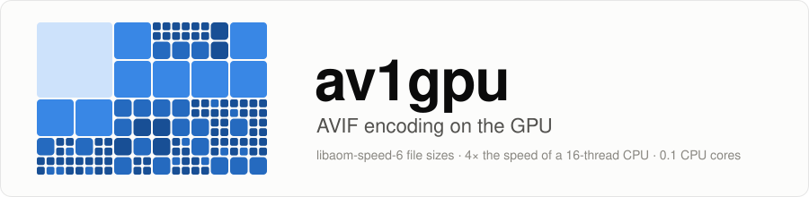
  </picture>
</p>

<p align="center">
  <a href="https://github.com/maddog107/av1gpu/releases"></a>
  <a href="https://github.com/maddog107/av1gpu/actions/workflows/ci.yml"></a>
  <a href="LICENSE"></a>
  
  
  <a href="docs/RESULTS.md"></a>
  <a href="https://github.com/maddog107/av1gpu/stargazers"></a>
</p>

<p align="center">
  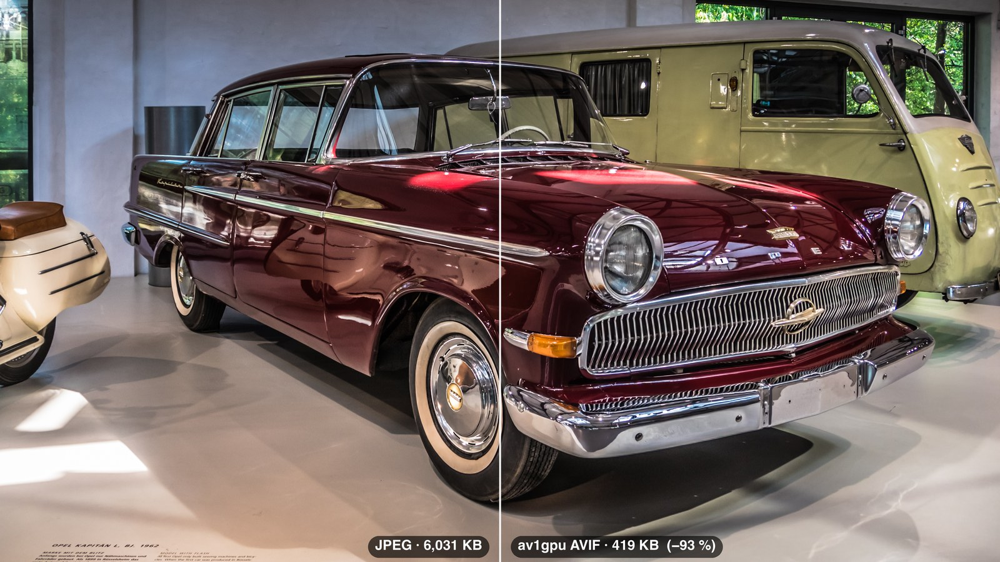<br>
  <sub>Left: the original 12 MP JPEG, 6,031 KB. Right: av1gpu's AVIF at the default quality, 419 KB.
  Photo: <a href="https://www.flickr.com/photos/yakobusan/20438833739">Untitled</a> by Jakob Montrasio, CC BY 2.0.</sub>
</p>

> [!TIP]
> **TL;DR:** av1gpu turns JPEGs into AVIFs on an NVIDIA GPU **4× faster than libaom running on all 16 CPU
> threads at once**, with the **same file sizes** (libaom speed 6, −0.1 %), while using only **0.1 of a CPU
> core**. The 100 test photos went from **160 MB of JPEG to 22.5 MB of AVIF (−86 %)**, and its files are
> **31 % smaller than WebP** at the same quality. SVT-AV1 needs presets 4–6 on all 16 threads (16–49 MP/s)
> for the same sizes, and on the same GPU av1gpu is **7× faster than NVIDIA's own NVENC AV1 encoder**,
> whose files are 30 % bigger. One prebuilt binary, no CPU farm.

## ⚡ Overview

A CUDA encoder for AV1 still images that writes AVIF. Mode search, partitioning, reconstruction,
loop-filter decisions and entropy coding all run on the GPU's general-purpose CUDA cores. It does not
use NVENC, the GPU's fixed-function video encoder, which on the same card is 7× slower and makes 30 %
bigger files ([below](#-same-gpu-av1gpu-vs-nvenc)). JPEG input is decoded on the GPU too, so a whole
batch of images stays in GPU memory from the JPEG bitstream to the finished AVIF bytes.

It was built for [Bellazon](https://www.bellazon.com), a forum with more than **15 million photos**:
32 million files with their thumbnails, 50 trillion pixels and 8.9 TB of originals. On one 70 W card
the whole archive is about 7 days of GPU time, while the server's CPUs carry on serving the site. At
the quality the forum chose, the AVIF files are 40 % smaller than the WebP it serves today, 1.5 TB less
to store and send (at equal quality, av1gpu's files are 31 % smaller than WebP's).

| | |
|---|---|
| **15 M+ photos** | Bellazon's archive (32 M files, 50 trillion pixels) in about 7 GPU-days on one card |
| **116 MP/s** | on one NVIDIA L4, a 72 W data-centre card (with `GP_ENCODERS=4`) |
| **−0.1 %** | file size against libaom speed 6 at equal quality (median BD-rate, SSIMULACRA2) |
| **−31 %** | file size against WebP at equal quality |
| **0.1 cores** | of CPU while encoding, so the CPU stays free for other work |
| **bit-exact** | every test encode decodes to the encoder's own reconstruction in dav1d and libaom |

## 🎬 See it run

99 camera photos (478 MP, 154 MB of JPEG) converted on the RTX PRO 2000, recorded in real time:

<p align="center">
  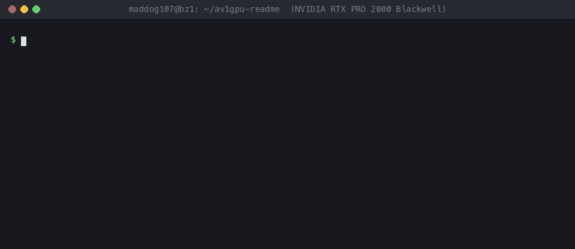
</p>

That run includes CUDA start-up; on longer batches the speed settles at the figures below.

## 📊 Results

Measured on an AWS g6.4xlarge (NVIDIA L4, AMD EPYC 7R13 with 16 vCPUs) with 100 public
[Open Images](https://storage.googleapis.com/openimages/web/index.html) photos from 0.18 to 24 MP, against
avifenc 1.4 with libaom 3.13.1 (`tune=iq`) and SVT-AV1 4.2.0 (`tune=3`, its still-image mode), one
avifenc per vCPU. Full numbers, method and logs:
[docs/RESULTS.md](docs/RESULTS.md#nvidia-l4-aws-g64xlarge); reproduce them with [Benchmarks](#-benchmarks).

<picture>
  <source media="(prefers-color-scheme: dark)" srcset="docs/charts/tradeoff-dark.svg">
  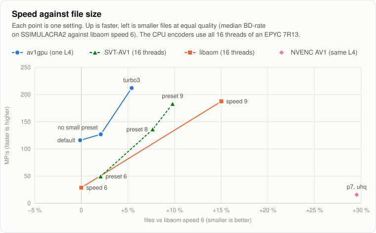
</picture>

**Speed against file size:** up is faster, left is smaller files. From libaom-speed-6 sizes up to +5 %, av1gpu
on one GPU is 2.4–4× faster than the best CPU encoder on all 16 threads (interpolating between SVT-AV1
presets). For the smallest files, SVT-AV1's slow presets go further (preset 2: −5.1 %, at 4.6 MP/s);
av1gpu's own `--preset slow` has not been timed on the L4 yet.

Each encoder has a "small files" setting and a "fast" setting, so there are two fair match-ups. A third
compares av1gpu with NVENC, the AV1 hardware encoder built into the same GPU.

### 🐢 Smallest files: av1gpu default vs libaom speed 6 and SVT-AV1

<picture>
  <source media="(prefers-color-scheme: dark)" srcset="docs/charts/match-small-dark.svg">
  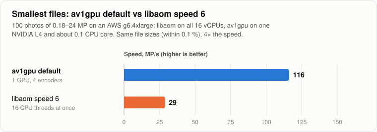
</picture>

**At the same file size, av1gpu is 4× faster than libaom running on all 16 CPU threads at once**,
and it leaves the CPU almost idle (0.1 of a core). SVT-AV1 brackets the same size with preset 6 (49 MP/s,
files 2.1 % bigger) and preset 4 (16 MP/s, 2.6 % smaller).

### 🐇 Fastest: av1gpu turbo3 vs SVT-AV1 preset 9 and libaom speed 9

<picture>
  <source media="(prefers-color-scheme: dark)" srcset="docs/charts/match-fast-dark.svg">
  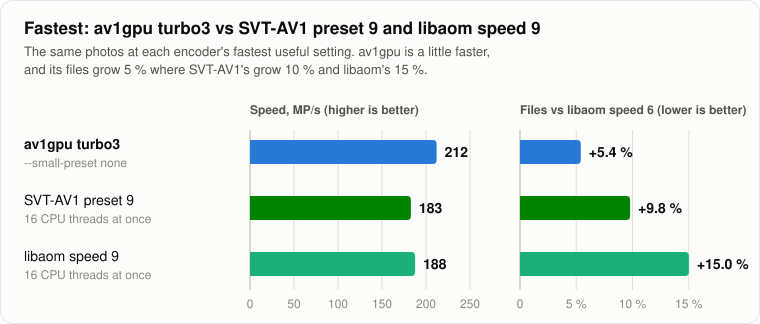
</picture>

**A little faster than both, and av1gpu's files grow about half as much as SVT-AV1's and a third as much
as libaom's:** +5.4 % against libaom speed 6, where SVT-AV1 preset 9 pays +9.8 % and libaom speed 9 +15 %.
av1gpu uses 0.2 of a CPU core; the CPU encoders need all 16 threads. libaom speed 10 is no faster than 9
for still images, and SVT-AV1 runs presets 10–13 as 9 when every frame is intra.

The `turbo3` speed was measured on the same L4 in a separate session, on 99 of the 100 photos (the default
gave 119 MP/s there, against 116 in the main run).

### 🆚 Same GPU: av1gpu vs NVENC

<picture>
  <source media="(prefers-color-scheme: dark)" srcset="docs/charts/match-nvenc-dark.svg">
  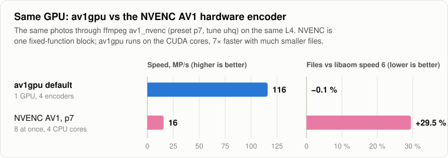
</picture>

**7× faster than the GPU's own AV1 encoder, with files 23 % smaller.** NVENC is a fixed-function block
(the L4 has two), so it tops out at about 16 MP/s however many encodes you run at once, and it keeps
4 CPU cores busy decoding JPEGs for it. Its files are 29.5 % bigger than libaom speed 6's at equal
quality, worse than libaom speed 9. Tested through ffmpeg `av1_nvenc` at its best-quality setting (`-preset p7
-tune uhq`) on 99 of the photos; details in
[docs/RESULTS.md](docs/RESULTS.md#nvenc-av1-on-the-same-l4).

### 📈 Quality and file size

<picture>
  <source media="(prefers-color-scheme: dark)" srcset="docs/charts/quality-dark.svg">
  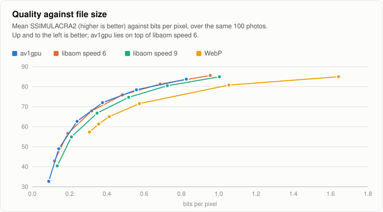
</picture>

<picture>
  <source media="(prefers-color-scheme: dark)" srcset="docs/charts/by-size-dark.svg">
  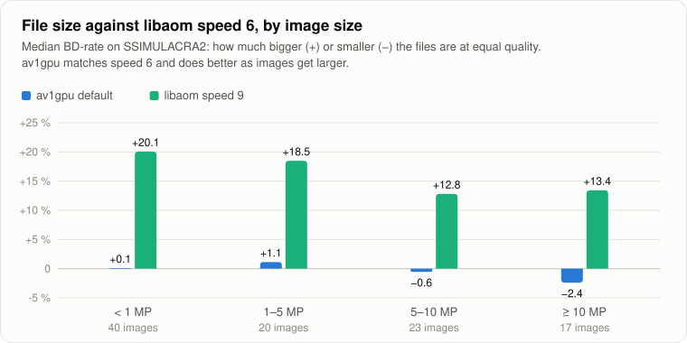
</picture>

| Encoder | MP/s | Files vs libaom s6 | Files vs WebP | CPU cores |
|---|---:|---:|---:|---:|
| **av1gpu** default, `GP_ENCODERS=4` | **116** | **−0.1 %** | **−31.2 %** | 0.1 |
| av1gpu `--small-preset none` | 127 | +2.1 % | | 0.1 |
| av1gpu `--preset turbo3 --small-preset none` | 212¹ | +5.4 % | | 0.2 |
| libaom speed 6, 16 × avifenc | 29 | 0 | −31.1 % | 16 |
| libaom speed 9, 16 × avifenc | 188 | +15.0 % | −19.3 % | 16 |
| SVT-AV1 preset 2, 16 × avifenc | 4.6³ | −5.1 % | −34.7 % | 16 |
| SVT-AV1 preset 4, 16 × avifenc | 15.5³ | −2.6 % | −32.8 % | 16 |
| SVT-AV1 preset 6, 16 × avifenc | 49³ | +2.1 % | −28.0 % | 16 |
| SVT-AV1 preset 8, 16 × avifenc | 136³ | +7.7 % | −23.8 % | 16 |
| SVT-AV1 preset 9, 16 × avifenc | 183³ | +9.8 % | −22.8 % | 16 |
| WebP (cwebp `-m 4`) | | +45.1 % | 0 | |
| NVENC AV1 (ffmpeg `av1_nvenc -preset p7 -tune uhq`), 8 at once | 16² | +29.5 % | −12.2 % | 4 |

¹ Measured in a separate L4 session on 99 of the 100 photos, where the default ran at 119 MP/s.
² Same L4, separate session, 99 photos; the av1gpu default ran at 116 MP/s alongside it.
³ On a c6a.4xlarge, the same EPYC 7R13 with 16 vCPUs, 99 photos; libaom ran alongside at 28.7 and 186.4 MP/s,
and its speed 6 files and scores were identical to the main run's.

### 🖼️ What the files look like

The default quality (`--quality 60`, the avifenc scale) turned the 100 test JPEGs, 160.4 MB, into
22.5 MB of AVIF, at a mean SSIMULACRA2 of 72 ("high quality"; 90 is visually lossless). `--quality 70`
gave 33.4 MB at 78. Five of the photos, one from each size class:

<table>
  <tr>
    <td align="center" width="20%"><br><b>90 KB → 27 KB</b><br>−70 % · 640 × 427</td>
    <td align="center" width="20%"><br><b>177 KB → 60 KB</b><br>−66 % · 1024 × 768</td>
    <td align="center" width="20%">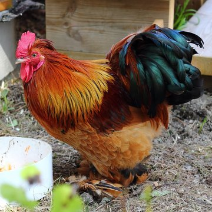<br><b>2.06 MB → 177 KB</b><br>−91 % · 1920 × 1280</td>
    <td align="center" width="20%">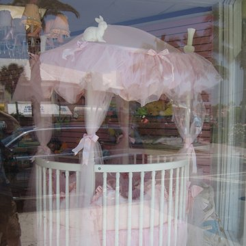<br><b>1.88 MB → 212 KB</b><br>−89 % · 2304 × 3072</td>
    <td align="center" width="20%">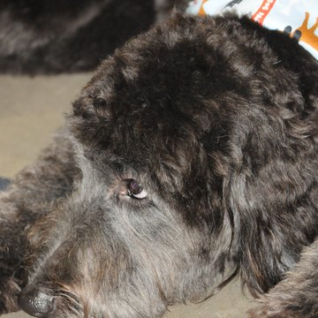<br><b>6.08 MB → 578 KB</b><br>−90 % · 2848 × 4288</td>
  </tr>
</table>

SSIMULACRA2 against the source: 67.9, 77.3, 73.7, 71.1 and 69.0. Thumbnails are cropped from av1gpu's
output. Photos (CC BY 2.0): [DSC08815](https://www.flickr.com/photos/stupiddingo/4016599113) by Brent,
[Fresh Red Peppers at La Boqueria](https://www.flickr.com/photos/oh-barcelona/4811363097) by Oh-Barcelona.com,
[Cock](https://www.flickr.com/photos/kallegustafsson/5866854319) by Kalle Gustafsson,
[St.Armands Circle](https://www.flickr.com/photos/philliecasablanca/2037727892) by Phil Whitehouse and
[DSC_2946](https://www.flickr.com/photos/hockeyholic/7881222604) by Andy Blackledge.

Camera originals shrink the most, because they are stored at high JPEG quality. SSIMULACRA2 here compares
the AVIF with the decoded JPEG, not with the scene.

The RTX PRO 2000 and the L4 produced byte-identical files for all five.

### 🔍 Same file size, side by side

Each encoder was pushed to the size of av1gpu's file (the highest quality setting that fits), then the
same spot was cropped and enlarged 2×. av1gpu and libaom speed 6 keep the chrome bars of the grille
crisp; speed 9 and WebP soften them, and JPEG turns them into blocks.

<p align="center">
  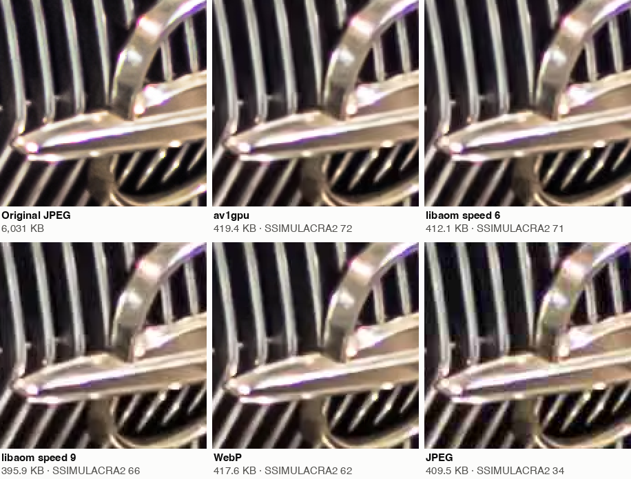
</p>

<details>
<summary>A second example: a dog's eye and fur, 12 MP (578 KB each)</summary>
<p align="center">
  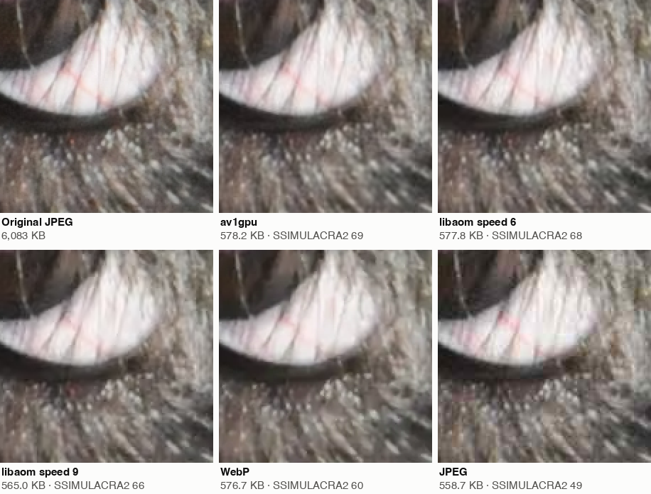
</p>
</details>

Crops of [Untitled](https://www.flickr.com/photos/yakobusan/20438833739) by Jakob Montrasio and
[DSC_2946](https://www.flickr.com/photos/hockeyholic/7881222604) by Andy Blackledge (CC BY 2.0), re-encoded
with av1gpu on the RTX PRO 2000, avifenc 1.4 / libaom 3.13 (`tune=iq`), cwebp `-m 4` and libjpeg 4:2:0.

**Every output is a standard AV1 bitstream, and the tests check that by decoding.** The encoder's
own reconstruction must match what dav1d and libaom's decoder produce, byte for byte. That held for
all 1,475 held-out encodes on the development GPU and all 1,000 encodes of the L4 run, and the test
suite keeps checking it (see [Correctness](#-correctness)).

## 🚦 Status

av1gpu is a working encoder that runs in production on Bellazon. It is also a young, single-developer
project. Before you rely on it, note:

- **It has been tested on two GPU models:** the RTX PRO 2000 Blackwell it was developed on (compute
  capability 12.0) and an NVIDIA L4 (8.9, on AWS; see [docs/RESULTS.md](docs/RESULTS.md#nvidia-l4-aws-g64xlarge)).
  The code uses only standard CUDA features, with no tensor cores, no architecture-specific intrinsics and
  no large shared-memory carve-outs. It builds for compute capability 7.5 through 12.0. Other GPUs should
  work but have not been run yet. Reports are welcome, especially `tests/decoder_gate.py` results.
- The output format is fixed: 8-bit 4:2:0 (or monochrome) AV1, intra only. 4:4:4 and 4:2:2 JPEGs are
  downsampled to 4:2:0. There is no alpha, 10-bit, animation or lossless mode.
- Some inputs are not handled on the GPU path. The batch mode skips them and lists them on stderr, so
  you can send them to another encoder: CMYK/YCCK JPEGs, 12-bit JPEGs, images over 35.6 MP and
  unreadable files. PNG and WebP inputs are decoded on the CPU.
- Tools not implemented: palette, intra block copy, loop restoration, superres, film grain.

## 🛠️ Building

You need Linux, CUDA 12.0 or newer (12.8 or newer to target Blackwell), CMake 3.24 or newer, a C++17
compiler, and libjpeg(-turbo), libpng and libwebp development packages.

```bash
# Ubuntu / Debian (plus the CUDA toolkit from NVIDIA)
sudo apt install cmake ninja-build pkg-config libjpeg-turbo8-dev libpng-dev libwebp-dev

cmake -S . -B build -G Ninja -DCMAKE_BUILD_TYPE=Release -DCMAKE_CUDA_ARCHITECTURES=native
cmake --build build
```

`-DCMAKE_CUDA_ARCHITECTURES=native` builds only for the GPU in the machine, which is much quicker.
Leave it out to build a portable binary for compute capability 7.5 through 12.0. The binary links the
CUDA runtime statically, so at run time it needs only the NVIDIA driver and `libnvjpeg`.

`-DAV1GPU_CUDA=OFF` builds just the CPU pieces: the bitstream writer, the AVIF muxer and the fuzz
test. That build needs no CUDA toolkit.

## 🚀 Usage

```bash
# one image
build/av1gpu photo.jpg photo.avif

# a directory (or a text file with one path per line): many images in flight at once
build/av1gpu --batch photos/ --outdir avif/            # writes avif/<name>.jpg.avif

# quality uses the avifenc -q scale (0..100; default 60)
build/av1gpu --batch photos/ --outdir avif/ --quality 70

# slower, smaller files
build/av1gpu --batch photos/ --outdir avif/ --preset slow
```

Batch mode is the fast path. It decodes, encodes and entropy-codes several batches at once, so the
GPU stays busy. Encoding images one process at a time is much slower, because each process pays
for CUDA start-up.

| Option | Meaning |
|---|---|
| `--quality Q` | 0–100 on avifenc's `-q` scale with `tune=iq` (60 → AV1 qindex 120) |
| `--qindex Q[,Q2,…]` | AV1 `base_q_idx` directly. In batch mode, several values run one pass each (add `--name-q` to suffix outputs with `.q<Q>`) |
| `--preset P` | `slow`, `base`, `fast`, `faster`, `turbo` (default), `turbo2`, `turbo3` |
| `--small-preset P` | preset for images below 1 MP (default `base`; `none` disables) |
| `--tune iq` / `none` | libaom `tune=iq` tools: quantization matrices, variance-boost delta-q, chroma delta-q, deblocking and CDEF strength choice (default `iq`) |
| `--cpu-entropy` | entropy-code on the CPU (produces bytes identical to the GPU coder) |
| `--stats` | print a JSON line with timings, throughput and CPU use |
| `--debug-outputs` | also write `<out>.obu` and `<out>.recon.yuv` for decoder comparisons |
| `--no-defaults` | start from the bare encoder instead of the defaults (research use) |

`av1gpu --help` lists the expert tuning options. The defaults are `--quality 60 --tune iq
--edge-filter --preset turbo --small-preset base --gpu-entropy`.

Batch-mode environment variables: `GP_ENCODERS` (concurrent encoders, default 3), `GP_ENCODE_MP`
(megapixels per GPU batch, default 48) and `GP_INGEST_WORKERS` (JPEG parsing threads, default 4).
The encoder needs about 1 GB of GPU memory with these settings, and the JPEG decoder about 0.6 GB more.
`GP_INGEST_DECODER=1` forces the CPU-entropy-decode + GPU-IDCT JPEG path on GPUs without a hardware
JPEG engine. av1gpu also falls back to that path automatically.

AVIF files carry the source's ICC profile. EXIF orientation is signalled with `irot`/`imir` rather
than by rotating pixels.

[examples/](examples/) has a directory converter with an avifenc fallback for skipped files, and an
nginx configuration that serves `image.jpg.avif` to browsers that accept AVIF.

## ✅ Correctness

The encoder keeps its own copy of the decoded picture. It needs that copy for prediction, and it is
also used to check every output against independent decoders:

```bash
# CPU only (no GPU needed): random legal encoder decisions -> av1core bitstream writer -> dav1d and aomdec
build/av1g_fuzz --count 1000            # or: ctest --test-dir build

# full GPU encoder, batch mode: every image must decode bit-exactly in dav1d and aomdec
tests/decoder_gate.py --bin build/av1gpu --images bench/images --q 60,120,180

# GPU entropy coder and GPU loop filters against the CPU reference
build/gpu_fuzz_test --count 2000
build/gpu_postfilter_test
```

`dav1d` and `aomdec` must be on `PATH` (Ubuntu: `apt install dav1d aom-tools`), or set `AV1G_DAV1D` /
`AV1G_AOMDEC`. During development the CUDA kernels were also run under compute-sanitizer
(memcheck, racecheck, synccheck) with clean results.

## 📏 Benchmarks

`bench/` reproduces the comparison on 100 public JPEGs from the
[Open Images](https://storage.googleapis.com/openimages/web/index.html) validation set (CC BY 2.0,
attribution in the CSV, about 1 MP each):

```bash
bench/fetch_images.py                                   # -> bench/images (33 MB, SHA-256 checked)
bench/bench.py --images bench/images --out bench/results/$(hostname)
```

It measures av1gpu throughput (the median of 3 runs after a warm-up) against all CPU threads running
avifenc at speeds 6 and 9. It also encodes every image at six quality points with av1gpu, libaom s6,
libaom s9 and WebP, scores them with SSIMULACRA2 and reports per-image BD-rates. It needs `avifenc`,
`avifdec`, `cwebp`, `dwebp` and libjxl's `ssimulacra2`; the script header shows how to get them. Results
from other GPUs are very welcome.

These images are small (about 1 MP), where the speed preset matters most. On the held-out set, small
images were where av1gpu compared worst against libaom and large images where it compared best. For a
spread of sizes there is a second set of 100 images from 0.18 to 24 MP (478 MP; the summary also breaks
the BD-rates down by size):

```bash
bench/fetch_images.py --manifest bench/openimages_v4_gamut.csv --out bench/images_gamut
bench/bench.py --images bench/images_gamut --out bench/results/$(hostname)-gamut
```

One original in that set (`9fba6f263f3c4f3e`) has since been changed on Flickr, so `fetch_images.py` now
skips it with a hash mismatch and the set is 99 images.

Speed runs repeat the set up to 1,000 MP (`--min-mp`), so that CUDA start-up does not dominate. Other
av1gpu settings can be timed through a wrapper script (`--av1gpu`, `--gpu-label`), and `--aom-speeds`
picks the libaom speeds to compare. With an avifenc built with SVT-AV1, `--svt-presets 2,4,6,8,9
--svt-tune 3` adds SVT-AV1 (`--skip-gpu` runs the CPU encoders alone).

## ⚙️ How it works

<picture>
  <source media="(prefers-color-scheme: dark)" srcset="docs/charts/pipeline-dark.svg">
  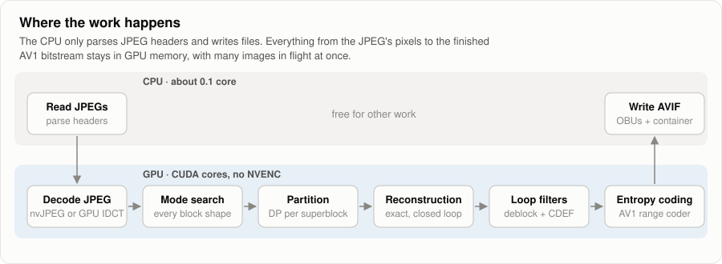
</picture>

Short version (details in [docs/ARCHITECTURE.md](docs/ARCHITECTURE.md)):

1. **Ingest.** JPEGs are parsed on the CPU and decoded with nvJPEG's hardware engine where one exists.
   Otherwise libjpeg-turbo does the entropy decoding on the CPU and the GPU does the IDCT. Either
   way the planes are bit-exact with libjpeg-turbo, and they are packed into size-classed batches in
   GPU memory.
2. **Analysis.** Every block shape from 4×4 to 64×64 is evaluated at every position. An open-loop
   SATD screen of the luma intra modes (directional with angle deltas, smooth, Paeth, DC) keeps the
   top K. Those K get an exact-rate RD check, then a transform-type search.
3. **Partition DP.** A dynamic program over each 64×64 superblock picks the partition tree.
4. **Closed loop.** Superblocks are reconstructed in wavefront order with the real, already-decoded
   neighbours. The top candidates are re-checked with exact entropy contexts. Chroma modes, CfL,
   quantization (with quantization matrices and per-superblock delta-q) and the exact integer inverse
   transforms run here, giving a bit-exact reconstruction. Many images are in flight at once, which
   hides the wavefront's serial dependencies.
5. **Loop filters.** Deblocking levels and CDEF strengths are chosen and applied on the GPU. The
   choice follows libaom's search for `tune=iq`.
6. **Entropy coding.** Symbols are generated and arithmetic-coded on the GPU with AV1's adaptive
   CDFs, coding the tiles of many images in parallel. The output is byte-identical to the CPU
   writer. Then OBUs are assembled and muxed into AVIF.

## 🗂️ Repository layout

| Path | Contents |
|---|---|
| `av1core/` | AV1 bitstream writer (CPU), GPU symbol generation and range coder, GPU deblocking/CDEF, AVIF muxer, spec tables |
| `encoder/` | GPU encoder: analysis, partition DP, closed-loop reconstruction, batching, the `av1gpu` CLI |
| `ingest/` | JPEG → GPU 4:2:0 planes (nvJPEG hardware path, or CPU entropy decode + GPU IDCT) |
| `av1f/` | libaom `tune=iq` decisions, variance boost, deblocking/CDEF strength search |
| `tests/` | decoder-identity fuzzers and gates |
| `bench/` | public-image benchmark |
| `tools/` | generators for the spec and libaom tables (outputs are checked in) |

## 📄 License

BSD 2-Clause, see [LICENSE](LICENSE). Parts of `av1f/` and the range coder are derived from libaom
(BSD 2-Clause, Alliance for Open Media); see [THIRD_PARTY_NOTICES.md](THIRD_PARTY_NOTICES.md). AV1 is
royalty-free under the AOMedia Patent License 1.0.
