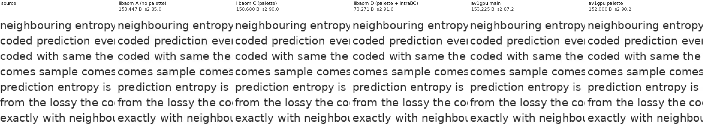
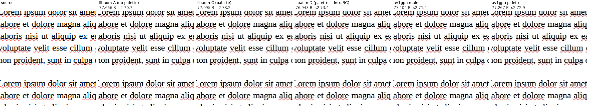
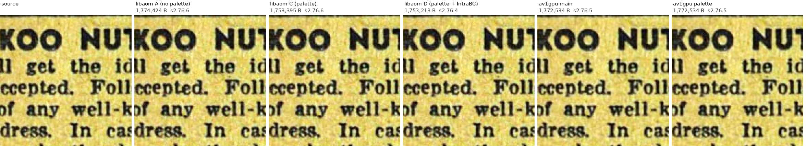

# Palette study: AWS g6.4xlarge (NVIDIA L4), 2026-11-02

How much do AV1's palette mode and intra block copy (IntraBC) save on comics, flat-colour art, screen content and
photos? This study measures it with libaom, then measures av1gpu on the same images: main, and the palette mode of
the feat/palette branch. The design and the implementation are in [docs/PALETTE.md](../../../docs/PALETTE.md).

- **Host:** g6.4xlarge on demand (NVIDIA L4, driver 595.112.07, 16 vCPUs), CUDA 13.2.
- **Encoders:**
  - libaom 3.13.1 through avifenc 1.4.0: speed 6, all-intra, `-a tune=iq`, `-j 1`, one process per vCPU;
  - av1gpu: main 60f94ff, and feat/palette;
  - cwebp 1.3.2.
- **Metrics:** SSIMULACRA2 and butteraugli (3-norm) from libjxl 0.11.1, on the dav1d 1.4.1 decode. BD-rate as
  `bench/bench.py` computes it, per image, then the median (and mean) over the images. Negative means smaller files
  at equal quality.

## Images

Licences, authors and source pages of every downloaded image are in
[bench/palette_study_images.csv](../../palette_study_images.csv) (97 files, with the SHA-256 of each file as
served). No image is committed. The crops below are small excerpts under each image's own licence (attribution in
the manifest).

| Set | n | MP | What |
|---|---:|---:|---|
| comics | 31 | 223.6 | Scanned public-domain comic pages: Superworld Comics 1940 (11.4 MP pages), America's Greatest Comics 1941 (6.1 MP) and three 1949–54 books (archive.org, Public Domain Mark), 6 Little Nemo Sundays (1905–09, Wikimedia Commons) |
| flat_png | 24 | 102.5 | Flat-colour and anime-style art from Commons (CC BY-SA / CC BY / CC0): 18 PNG originals and 6 SVGs rendered at 2560 px, flattened onto white |
| flat_jpg | 24 | 102.5 | The same art as JPEG q90 4:2:0, the version that circulates on forums |
| painted | 6 | 52.1 | Pepper&Carrot pages (David Revoy, CC BY 4.0): a painted webcomic, JPEG as published |
| screen | 40 | 79.3 | The 23 graphics of the lossless comparison (16 charts, 7 synthetic screenshots), 12 real screenshots from Commons, 5 Wikipedia articles rendered by headless Chrome |
| photo | 44 | 117.8 | The 24 Kodak images (PNG) and 20 size-range JPEGs (the first 4 of each size class of `bench/openimages_v4_gamut.csv`) |

## libaom: what palette and IntraBC are worth

Four configurations, which differ only in the screen-content switches:
- **A:** `enable-palette=0 enable-intrabc=0`.
- **B:** libaom's default; its own detection decides.
- **C:** `tune-content=screen enable-intrabc=0`, palette only.
- **D:** `tune-content=screen`, palette and IntraBC.

C0 (C with palette off) shows that forcing the screen mode changes nothing else: it is 0.0 % against A on every
set.

BD-rate on SSIMULACRA2 against A, median (mean), 8-bit 4:2:0, quality 30–90. Every table, including butteraugli
and 10-bit 4:4:4, is in [tables.md](tables.md).

| Images | n | C | D | B | av1gpu main |
|---|---:|---:|---:|---:|---:|
| comics | 31 | −0.5 % (−0.7) | +1.3 % (+1.7) | 0.0 % (0.0) | +1.3 % (+1.2) |
| flat PNG | 24 | −4.4 % (−8.3) | +0.4 % (−3.6) | 0.0 % (−3.9) | +6.7 % (+6.7) |
| flat JPEG q90 | 24 | −5.7 % (−8.5) | +1.0 % (−2.3) | 0.0 % (−0.6) | +1.4 % (+1.4) |
| painted | 6 | −2.5 % (−2.8) | +3.8 % (+4.0) | 0.0 % (−0.3) | +2.0 % (+2.3) |
| screen: 23 graphics | 23 | −14.7 % (−19.6) | −19.6 % (−29.0) | −19.6 % (−29.0) | −2.4 % (−1.9) |
| screen: 12 screenshots | 12 | −18.3 % (−18.7) | −35.5 % (−29.3) | −35.5 % (−29.5) | −2.4 % (−1.2) |
| screen: 5 web renders | 5 | −17.8 % (−16.8) | −33.2 % (−31.5) | −33.2 % (−31.5) | −0.1 % (−0.6) |
| photos | 44 | −0.2 % (−0.1) | +2.6 % (+3.3) | 0.0 % (0.0) | +1.2 % (+0.9) |

- **Palette (C)** is worth 15–18 % on screen content and 4–6 % on flat-colour art. It is worth nothing on comics
  and photos: scans have halftone dots and paper grain, so few blocks hold a handful of colours.
- **IntraBC (D)** adds 5–17 points on screen content. Everywhere else it costs 1–5 %, because a frame with IntraBC
  allowed has no deblocking and no CDEF.
- **libaom's detection (B)** turns the screen-content tools on for all 40 screen images (IntraBC on 39), 14 of the
  24 flat PNGs (IntraBC on 11), 4 flat JPEGs, 1 painted page, no comic, and 2 of the 44 photos (kodim20, and a
  432×639 JPEG). On those two photos it gains nothing.
- **libaom's encode time** with palette forced (C against A) is 1.1–1.3× on screen content, and 1.4–1.6× on
  everything else, where the search finds little. D costs 1.3–2.3×.
- **av1gpu main** is within 2.5 % of libaom A on every class except the flat PNGs (+6.7 %; butteraugli +9.8 %).
  Its gap to libaom on screen content is the tools.

Lossless (the PNG sets): total bytes, and the ratio to `avifenc -l` A. Every file was decoded and compared with its
source, and all are exact.

| Images | n | A | C | D | D YCgCo-R | av1gpu main | main YCgCo-R | cwebp `-lossless -z 9` |
|---|---:|---:|---:|---:|---:|---:|---:|---:|
| flat PNG | 24 | 36.25 MB | 0.85 | 0.85 | 0.61 | 0.79 | 0.62 | 0.45 |
| screen | 40 | 31.65 MB | 0.66 | 0.53 | 0.39 | 0.71 | 0.56 | 0.16 |
| Kodak | 24 | 13.69 MB | 1.00 | 1.00 | 0.90 | 0.98 | 0.88 | 0.82 |

## av1gpu with palette (feat/palette)

The branch adds palette mode: luma palettes in lossy frames, luma and chroma palettes in lossless ones. It runs only
on images that pass a screen-content detection: libaom's, plus a minimum value range per block (docs/PALETTE.md).
Settings are the defaults, quality 30–90 (`bench.py`'s quality → qindex table); full tables are in
[tables_branch.md](tables_branch.md).

BD-rate on SSIMULACRA2, median (mean):

| Images | n | vs av1gpu main | vs libaom A | vs libaom C | vs libaom D | 10-bit 4:4:4 vs main |
|---|---:|---:|---:|---:|---:|---:|
| screen: all | 40 | −23.6 % (−24.0) | −24.9 % (−26.0) | −9.5 % (−8.7) | +3.3 % (+11.3) | −19.5 % (−19.5) |
| screen: 23 graphics | 23 | −23.3 % (−25.3) | −25.1 % (−27.7) | −10.3 % (−10.1) | −3.9 % (+11.8) | −18.5 % (−20.6) |
| screen: 12 screenshots | 12 | −24.7 % (−21.7) | −23.9 % (−22.9) | −6.3 % (−5.8) | +12.8 % (+10.8) | −18.7 % (−16.6) |
| screen: 5 web renders | 5 | −24.6 % (−23.5) | −27.2 % (−25.3) | −8.4 % (−9.0) | +7.7 % (+9.9) | −21.9 % (−21.3) |
| flat PNG: all | 24 | 0.0 % (−7.4) | +3.8 % (−1.2) | +5.6 % (+7.2) | −0.4 % (+2.5) | 0.0 % (−4.7) |
| flat PNG: the 11 that pass detection | 11 | −22.3 % (−16.2) | −12.5 % (−10.0) | +0.7 % (+0.9) | −1.1 % (−2.3) | −12.7 % (−10.3) |
| comics, flat JPEG, painted, photos | 105 | identical files | | | | identical files |

Butteraugli agrees: screen −23.1 % against main, and the 11 detected flat PNGs −16.3 %.

- **How the gain came:** the first version had k-means palettes of 8 colours only, and gained 3 % on screen content.
  Trying the exact top colours and every size from 8 down, as libaom does, made it 24 %.
- **Palette area:** palettes cover 24.4 % of the screen images' area at q60 (libaom C: 17.8 %) and 8.4 % of the
  flat PNGs' (libaom C: 8.8 %), counted by `pstat` on the av1gpu files.
- **Detection:** it passes 38 of the 40 screen images, 11 of the 24 flat PNGs, and no flat JPEG, painted page, comic
  or photo. Of the 244 photos checked (the 100 of the size range, the 100 of the standard set and the 44 here),
  libaom's rule alone passes 17. With av1gpu's range condition it passes none, and the highest score is 0.12, against a
  threshold of 1.

`--palette on` (no detection; `rows/palette_on_scored_lossy.jsonl.gz`), BD-rate on SSIMULACRA2, median (mean):

| Images | n | vs av1gpu main | vs libaom A | vs libaom C | vs libaom D | 10-bit 4:4:4 vs main |
|---|---:|---:|---:|---:|---:|---:|
| flat PNG | 24 | −6.8 % (−11.4) | −1.4 % (−5.4) | +2.7 % (+2.5) | −2.1 % (−2.0) | −3.2 % (−7.2) |
| flat JPEG q90 | 24 | −5.9 % (−8.9) | −3.3 % (−7.4) | +1.0 % (+0.9) | −5.2 % (−5.1) | −3.3 % (−6.9) |

Butteraugli: −9.0 % and −8.2 % against main.

Lossless, against main, every file exact in dav1d and libaom:

| Images | n | GBR | YCgCo-Re |
|---|---:|---:|---:|
| the 23 graphics | 23 | 6.77 → 6.09 MB (−10.1 %) | 4.84 → 4.36 MB (−9.9 %) |
| screen: all | 40 | 22.44 → 20.50 MB (−8.7 %) | 17.65 → 16.27 MB (−7.8 %) |
| flat PNG | 24 | 28.77 → 27.71 MB (−3.7 %) | |
| Kodak | 24 | identical | identical |

### Speed

MP/s on the L4, with the method of `aws-g6-l4-speed-v06/scripts/spd.py` (`scripts/spd_pal.py`): each set
repeated to at least 1,000 MP, a warm-up and 3 timed runs, 2 rounds with alternating order, the median of the 6
(`checks/spd_*.out`, `checks/spd/`):

| Images | main | feat/palette | change |
|---|---:|---:|---:|
| size range (100 photos), default | 229.3 | 226.3 | −1.3 % |
| size range, `--yuv 444 --depth 10` | 162.2 | 163.8 | +0.9 % |
| standard set (100 photos), default | 74.4 | 75.0 | +0.8 % |
| size range, main against main (noise) | | | +0.2 % (+0.9 % in an earlier run) |
| size range, `--palette off` | 227.5 | 225.3 | −1.0 % |
| repeat on the merged tree (main fb50bcb + branch): size range default / 444 10-bit / standard | | | −1.1 % / −0.7 % / +3.1 % (noise +0.5 %) |
| screen + flat PNG (64 images), default | 152.7 | 57.0 | 0.37× |
| the same, `--palette off` | 155.9 | 150.8 | −3.3 % |
| the same, `--palette on` | 150.6 | 37.2 | 0.25× |
| the same, `--lossless` (`GP_ENCODE_MP=12`) | 51.6 | 49.3 | −4.5 % |
| the same, `--lossless --ycgco-re` | 50.4 | 46.9 | −6.9 % |

- **Photos:** within noise.
  - The detection kernel takes 0.09 ms of a 64 ms photo encode (ncu, `scripts/ncu.sh`).
  - The first build lost 2–3 % on photos, for two reasons. The detection kernel ran one thread per block (1.03 ms),
    and the closed loop's per-pixel predictor had a palette branch (that kernel is at its 128-register cap).
  - Lossy batches never wait for the detection on the host.
- **Screen content runs at 0.37× main's speed.** The palette search costs 17.7 s of extra analysis GPU time per
  1,400 MP. The entropy coder's GPU time grows from 3.1 to 17.2 s, because a palette block codes one symbol per
  pixel; it runs on its own stream.
- **A cheaper search** (an experiment build, not in the branch; `scripts/chain6.sh`, `rows/fast_scored_lossy.jsonl.gz`):
  k-means only at the largest size, and a stop at the first size without improvement. It ran at 102.5 MP/s against
  main's 153.0 (0.67×), but saved only 9.8 % (median) on screen content instead of 23.6 %.

### Checks

- **Byte identity against main** (`checks/ident_final.out`, `checks/ident_off.out`, `checks/cmpsets_br2.out`): every file
  compared with `cmp`.
  - The standard set (100) and the size range (100), default and `--yuv 444 --depth 10`; Kodak `--lossless` and
    `--lossless --ycgco-re`: all identical.
  - The study's comics, flat JPEGs, painted pages and photos at the five quality points, 8-bit 4:2:0 and 10-bit
    4:4:4: 1,050 of 1,050 identical.
  - `--palette off` on the 64 screen and flat PNGs (default, `--yuv 444 --depth 10`, `--lossless`, `--lossless
    --ycgco-re`): 256 of 256 identical.
- **Decoder gate** (`checks/gate_final.out`): `tests/decoder_gate.py` with dav1d 1.4.1 and aomdec 3.13.1, the encoder's
  reconstruction byte for byte. It ran on the 40 screen images and 24 flat PNGs: 4:2:0 at qindex 120, 60 and 20;
  4:4:4 at 120 and 40; 10-bit at 120 and 40; 10-bit 4:4:4 at 80; lossless GBR and YCgCo-Re. The 30 flat JPEGs and
  painted pages ran at 120 and 60. All 12 runs passed N/N, 700 files in total.
- **Lossless round trip** (`checks/lltest_*.out`): every palette-coded lossless file decodes to its source in libavif
  with dav1d and with libaom.
- **CPU fuzz** with palettes (`tests/fuzz.cpp`, 3,000 cases, seeds 5000–7999): 0 mismatches in dav1d and aomdec,
  0 parser round-trip failures. The run had 400 palette cases with 41,421 luma and 20,169 chroma palettes, and covered lossless,
  4:4:4, 10-bit, tiles, cache hits, 4×16 / 16×4, off-screen maps and SB top rows.
- **ctest** (`checks/ctest2.out`, aomdec on PATH): 9 of 9 pass.
- **GPU fuzz test** (`checks/gpu_fuzz*.out`): the GPU entropy coder against the CPU writer. 300 cases and 200
  lossless cases had 0 mismatches. It found a stack overflow first: the recursive partition walk needs 1,424 bytes
  with palettes, against the 1 KB default. `run_batch_device` now raises the limit to 2 KB.
- **The merged tree** (origin/main fb50bcb + this branch, `checks/ident_merged.out`): photos are byte-identical to
  main as above.

## Side-by-side crops at equal file size

`scripts/crops.py`: each file of the panel is the largest one no bigger than libaom A's q60 file (libaom: the highest
`-q`, `-j 16`; av1gpu: the lowest `--qindex`). Regions of 192 × 192 source pixels are shown at 2× (nearest
neighbour) as source | A | C | D | av1gpu main | av1gpu palette, with each file's size and its whole-image
SSIMULACRA2 above it (`crops/`, `crops.json`).

| Image | target | A | C | D | av1gpu main | av1gpu palette |
|---|---:|---:|---:|---:|---:|---:|
| synthetic text screenshot | 153,447 B | 85.0 | 90.0 | 91.6 (73,271 B at `-q 99`) | 87.2 | **90.2** |
| LibreOffice Writer screenshot | 77,666 B | 70.7 | 73.2 | 73.4 | 71.4 | **72.9** |
| Wikipe-tan mopping (PNG; not detected) | 119,597 B | 81.9 | 82.0 | 81.7 | 81.4 | 81.4 |
| the same as JPEG q90 | 127,811 B | 81.7 | 82.0 | 81.4 | 81.8 | 81.8 |
| America's Greatest Comics p. 138 | 877,085 B | 69.6 | 69.5 | 69.3 | 69.5 | 69.5 |
| Superworld Comics p. 129 | 1,774,424 B | 76.6 | 76.6 | 76.4 | 76.5 | 76.5 |

On the two screenshots palette mode gives av1gpu 3.0 and 1.5 points of SSIMULACRA2 at the same size, close to libaom
C and D. The text screenshot is the extreme case: D's IntraBC finds its repeated glyphs, and at libaom's best
setting below lossless the file is still half the target. The flat-colour and comic crops are unchanged, because
detection skips them.

## Files

- `tables.md`, `results.json`: the libaom and av1gpu-main tables (`scripts/analyze.py`).
- `tables_branch.md`, `tables_palette_on.md`, `tables_fast_experiment.md`: the branch, `--palette on`, and the cheaper
  search, each against main and libaom (`scripts/analyze_br.py`).
- `rows/`: one JSON row per encoded file (settings, bytes, encode time, scores, and libaom's decisions from `pstat`).
  - `scored_lossy.jsonl.gz`, `scored_ll.jsonl`: libaom, cwebp and av1gpu main;
  - `branch_scored_lossy.jsonl.gz`: the branch;
  - `palette_on_scored_lossy.jsonl.gz`: `--palette on`;
  - `fast_scored_lossy.jsonl.gz`: the cheaper search.
- `detect.txt`: av1gpu's detection counts per study image, from the experiment build that chose the range condition.
  The columns are libaom's score, then the score with a range of 8, 16, 32 and 64 levels; av1gpu uses 8
  (`scripts/detect_eval.py`).
- `detect_photos.txt`: the size range, the standard set and the study's photos (`GP_SC_DEBUG=1`).
- `detect_vs_libaom.txt`: the port against libaom's own decision.
- `checks/`: byte identity, decoder gates (`gate/`), lossless round trips, ctest, the GPU fuzz test, and speed
  (`spd_*.out`, `spd/`).
- `crops/`: the side-by-side crops and `crops.json`.
- `scripts/`, run in this order:
  - `setup.sh`, `make_palette_manifest.py`, `render_pages.sh`, `prep_sets.py`, `study.py`, `analyze.py`;
  - then the branch checks, `chain.sh` to `chain7.sh`. They call `ident.sh`, `ident_off.sh`, `gate.sh`, `lltest.sh`,
    `recheck.sh`, `spd_pal.py`, `detect.sh` and `crops.py`;
  - then `analyze_br.py`.

  `pstat.c` replaces libaom's `examples/inspect.c` and prints each libaom file's frame flags and palette / IntraBC
  block counts. `ncu.sh` gives the per-kernel GPU times.
